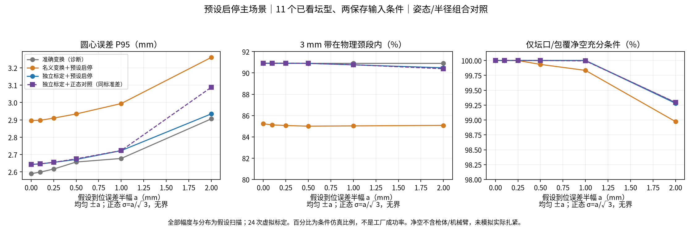

# 三工位工程推进：实际新增了什么

2026-10-28，正式结果 `experiments/neck_localization/results/cross_station_20261028_v3/`。沿用[上一轮三工位结果](three_station_tying_20261028.md)，原始数据/预测/查看默认不改。**本轮主输送场景按用户最新说明采用预设启停＋沿传送带的小幅随机净到位误差；没有假设工厂装编码器。** 运行时坛体/托盘/标记二次观测继续保留为后续建议，本轮未实施。

最有价值的结果是：把“视觉估计得准”“变换传递得准”“3mm带能放进去”“枪头有净空”拆开验证。独立标定能减小附加误差，但现有失败坛型仍未全部解决。以下百分比全是指定假设下的条件样本比例，**不是工厂扎口成功率**。

## 1. 三项工作各加了什么

| 工作 | 实现 | 采用/保留决定 |
|---|---|---|
| 带落点余量 | 简单组合：SimSense+标准SOR提供中心/法向，FS+visible_profile提供半径；另对FS实际点在该中心±1.5mm薄层内用Huber重估半径 | 简单组合作为可选工程对照保留；局部重估半径尾部更差，不设默认。两路共享IR，不宣称独立信息融合或校准置信度 |
| 跨工位误差 | 虚拟参考测量→标准加权LS/Huber标定→完整刚体位姿链；偏差每批固定，停止误差每周期改变 | 采用这种测量层级和独立参考检查；数值幅度尚为假设。编码器仅技术对照，主场景无端点反馈 |
| 工具/包覆净空 | 对实际三角网格做轴向薄层裁剪，求径向外包络，给双弧枪头内孔的充分净空条件；扫描头厚和包覆厚度 | 解决上一轮粗点采样保守界限“未确认”的问题；不是靠放宽阈值。负余量仍标未确认，不能当已证实碰撞 |

通用代码为 `neck_localization/task_circle_fusion.py`、`cross_station_uncertainty.py`、`tool_clearance.py`；实验和CLI在 `scripts/run_cross_station_study.py`、`run_timed_stop_study.py`。完整文献、适用条件、坐标和假设见[误差建模调研](cross_station_uncertainty_review_20261028.md)。没有训练网络、操作机器人、采集/修改标定或提交推送。

## 2. 带落点与尺寸：四个公平对照

沿用按物理颈段6–10mm、总倾角≤15°筛选后的11个既有圆截面模型（原28保留11，17不删）。其中实际保留样本倾角最大11.68°，未新渲染15°边界。两种保存传感器条件各11个预测；四种读出共88条。它们均已看，不再称独立测试集。所有组合仅用保存观测，产生预测之后才读真值评价。

| 方法 | 原始/扰动：3mm整带包含 | 最大直径误差mm（原始/扰动） | 原始圆心误差mm：中位/P95/最大 | 最大法向误差°（原始/扰动） |
|---|---|---|---|---|
| FS+visible（原方案） | 6/11、6/11 | 2.582 / 2.914 | 1.836 / 2.674 / 2.941 | 2.505 / 2.430 |
| SimSense+标准SOR | 10/11、10/11 | 9.231 / 9.446 | 1.290 / 2.496 / 2.678 | 1.075 / 1.041 |
| SOR姿态＋FS半径 | 10/11、10/11 | 2.582 / 2.914 | 1.290 / 2.496 / 2.678 | 1.075 / 1.041 |
| SOR姿态＋局部FS半径重估 | 10/11、10/11 | 3.474 / 3.389 | 1.290 / 2.496 / 2.678 | 1.075 / 1.041 |

全部原视觉接受11/11，中心4mm误拒/错误接受均0。**这不代表工艺放行正确：**FS每条件5/11虽接受但整带越界，另三法各1/11。直径2mm仅研究参考，不是厂方已定指标；按“整带＋直径2mm”组合为9/11。局部重估的直径中位误差改善到0.505/0.501mm，但最大值反而更大，故不增加此模块作为默认。

`new8/confirmation_nominal_001`仍是保留负例：简单组合原始输入的整带余量−0.380mm。不能通过把目标中心4mm判定放宽或把物理颈段扩长消掉它。当前组合继承SOR整段上下文，半径来自FS；它不是整条联合曲面重新拟合，也未解决短颈端点/曲面系统偏差。

更多指标在 `band_controls.json`，原始/扰动分别报告。新组合需要两条深度/几何链；本轮只是复用缓存验证后段，不报告完整实时收益。已有单链耗时也不能冒充新组合耗时。

## 3. 主场景：预设启停，没有编码器输入

`timed_stop_main/`：固定seed2026102823，24次虚拟标定×每次64个周期。净到位误差沿世界X；均匀±a扫0、0.1、0.25、0.5、1、2mm，另同标准差正态对照。**所有a、标定噪声及分布形状均是假设。** 对同一随机停止位置公平比较准确变换诊断、带偏差的名义变换、独立虚拟标定变换。指令始终只用名义2.4m位移；真到位偏差不传给规划器。

下表用简单姿态/半径组合，汇总两保存输入条件，比较名义变换和独立标定。标定是公共基准与工具的3D点配准，非实物精度保证。

| 假设均匀到位误差 | 变换 | 圆心mm：中位 / P95 / 最大 | 3mm带包含比例 | 仅坛口/包覆净空充分条件比例 |
|---|---|---|---|---|
| ±0mm | 名义 | 1.596 / 2.897 / 3.523 | 85.23% | 100% |
| ±0mm | 独立标定 | 1.397 / 2.643 / 2.836 | 90.91% | 100% |
| ±0.5mm | 名义 | 1.632 / 2.934 / 3.679 | 85.00% | 99.935% |
| ±0.5mm | 独立标定 | 1.434 / 2.672 / 2.913 | 90.89% | 100% |
| ±1mm | 名义 | 1.693 / 2.994 / 3.888 | 85.03% | 99.834% |
| ±1mm | 独立标定 | 1.556 / 2.723 / 3.064 | 90.76% | 100% |
| ±2mm | 名义 | 1.940 / 3.260 / 4.451 | 85.08% | 98.973% |
| ±2mm | 独立标定 | 1.894 / 2.935 / 3.667 | 90.48% | 99.281% |

准确变换且到位误差为0的诊断仍保留原视觉误差：圆心P952.590mm、整带10/11，不是零误差真值圆。沿X误差主要是切向：±0.5mm独立标定时，圆心误差增加有限，原始负例仍主导整带失败。更大的偏差开始侵蚀坛口通过净空。正态同标准差对照具有无界尾部，不能用均匀±a的最大值作它的保证。

±0.5mm主场景进一步分解如下（各栏为中位/P95/最大）：

| 变换 | 轴向绝对误差mm | 切向误差mm | 法向夹角° |
|---|---|---|---|
| 名义 | 1.303 / 2.720 / 3.266 | 0.721 / 1.577 / 2.582 | 0.371 / 0.971 / 1.319 |
| 独立标定 | 1.273 / 2.522 / 2.705 | 0.500 / 1.160 / 1.565 | 0.313 / 1.056 / 1.102 |

法向固定+Z朝坛口，用`atan2(norm(cross), dot)`，不靠取`abs(dot)`隐藏反向。标定也不保证每项统计量都改善：这里法向P95略升而最大值下降，仍有视觉偏差与标定偏差的抵消。完整分轴均值/P95及分解数组在 `component_summary.json`、`error_components.npz`。另用逐个齐次矩阵乘积独立复核主runner的向量化位姿链，圆心/带余量在浮点容差内一致；停止位置扰动不改变法向的检查通过。

未改变原接受器，也没有新现场放行器：这些保存预测本来全接受，因此误拒0；±2mm名义变换下最终圆心>4mm却仍沿用视觉接受标记的比例为0.331%，独立标定该组为0。**中心4mm内仍可能整带越界**，如±0.5mm独立标定约9.11%的条件样本，不能混记成“中心错误接受”。这是视觉接受不能覆盖后续未知误差的证据。

所有144组的中位/P95/最大、中心错误接受、整带比例和最小余量见 `timed_stop_main/checked_metrics.csv`；分布与原始样本在 `conditional_samples.npz`，失败批次/周期/坛型在 `retained_failure_examples.json`。每组33792个条件对照并非33792只独立酒坛，标定只24批；不据此宣称生产尾部可靠性。



## 4. 为什么要独立验标定，不能挑任务分数最高的版本

另保留10误差情景、5策略及0.5/1/2倍扫描的研究对照。对一异常参考点的干预，其他误差和原始测量噪声逐项配对；未标定两策略的输出逐位相同。

| 公共基准方案 | 无异常：独立核验最大误差的P95 mm | 仅一参考点异常：对应P95 mm |
|---|---|---|
| 广覆盖LS | 0.219 | 1.163 |
| 广覆盖Huber | 0.219 | 0.228 |
| 局部覆盖LS | 见原始表 | 2.038 |

有趣的反例：异常点使LS标定更错，但已看坛子的带包含分数从约90.3%变成91.3%，圆心P95也偶然下降；错误标定恰好抵消一部分视觉偏差。独立参考核验才看出1mm级问题。因此不根据已看坛子的通过率挑标定，不用拟合RMS替代绝对参考。

编码器对照在这里而不在主场景：原始端点读数受未校准尺度影响时，组合误差下圆心P953.333mm，甚至差于名义距离的3.070mm；独立标定后约2.630mm。这些仍是特定假设的对照，不能推论工厂需要/已有编码器，或任何编码器一定更好。详见调研中官方资料的适用边界。

## 5. 工具净空：修正保守评价，没有伪造物理成功

闭合可容纳内径150mm、张开60°、前端净空150mm保持；盖层按理想贴合厚度、枪头截面按圆管假设。精确裁剪三角网格时把与薄层边界相交的新顶点也计入，不再用粗稀疏点的过度保守界限。开合弧始终位于该内孔外侧，扣除多边形弦误差后给出充分条件。

11只×两主方案×头管半径1.5/3/5mm×盖层0/1/2/4mm，共264项。原始输入、盖层2mm/头管半径1.5mm时双方案共22/22可确认；上一轮20/22的两项未确认现得到正下界。关键负例 `_001` 的净空下界FS1.192mm、SOR1.614mm，但整带落点依然可能失败。盖层4mm时两方案均10/11可确认；该例下界−0.807/−0.385mm，仍是未确认而非证实碰撞。

这项使用精确模型真值只做评价，未给估计器提供真颈段/真遮盖。带宽和最终张紧后的形态仍是几何代理；这里不含枪体/全臂碰撞、柔性包覆、张力、摩擦、锁扣、剪断。最终扎口结果始终 `null`，不授实机执行许可。主场景随机偏差中只算更简单的坛口/包覆投影净空，不能冒充这项完整颈部网格证书。

## 6. 如何看与复现

继续原MuJoCo界面看新增组合（右侧仍是识别t0真实保存输入，关闭/下降等阶段可点左侧导航）：

```bash
conda run --no-capture-output -n winejar-stereo \
  python /home/wunicheng/Git/WineJar/scripts/view_tying_stage.py \
  --viewer /home/wunicheng/Git/WineJar/experiments/neck_localization/results/cross_station_20261028_v3/viewer \
  --condition new8/fusion/clean --case confirmation_nominal_003 --phase close --ground-truth
```

保留失败例将case改为 `confirmation_nominal_001`。组合的拟合点视图来自提供姿态的SOR分支，FS半径来源另有记录，不能把它解释成全部来自同一联合拟合。该MuJoCo束展示组合及理想工位传递；**本轮随机误差范围扫描在保存数组/图表中，没有冒称已逐样本动画回放。** 旧无参查看默认束不变。

以下依赖本机已有保存输入/权重产物与环境，无需训练或实机；输出目录必须尚不存在，以免覆盖旧结果：

```bash
cd /home/wunicheng/Git/WineJar
OPENBLAS_NUM_THREADS=1 OMP_NUM_THREADS=1 conda run --no-capture-output -n winejar-stereo \
  python scripts/run_cross_station_study.py \
  --output experiments/neck_localization/results/cross_station_20261028_replay
conda run --no-capture-output -n winejar-stereo python scripts/summarize_cross_station_study.py \
  --bundle experiments/neck_localization/results/cross_station_20261028_replay
conda run --no-capture-output -n winejar-stereo python scripts/verify_cross_station_study.py \
  --bundle experiments/neck_localization/results/cross_station_20261028_replay
OPENBLAS_NUM_THREADS=1 OMP_NUM_THREADS=1 conda run --no-capture-output -n winejar-stereo \
  python scripts/run_timed_stop_study.py \
  --output experiments/neck_localization/results/cross_station_20261028_replay/timed_stop_main
conda run --no-capture-output -n winejar-stereo python scripts/verify_timed_stop_study.py \
  --bundle experiments/neck_localization/results/cross_station_20261028_replay/timed_stop_main
OPENBLAS_NUM_THREADS=1 OMP_NUM_THREADS=1 conda run --no-capture-output -n winejar-stereo \
  python scripts/diagnose_timed_stop_study.py \
  --bundle experiments/neck_localization/results/cross_station_20261028_replay/timed_stop_main
```

配置：`configs/cross_station_20261028_v1.json`、`configs/timed_stop_20261028_v1.json`（相对 `experiments/neck_localization/`）。第一条保存原11坛预测/样本/工具扫描；第二套按用户最新启停说明独立重做主实验，不使用编码器观测。GL验证需要桌面显示，默认本机`:0`；它不连接设备。核心单测：

```bash
conda run --no-capture-output -n winejar-stereo \
  python -m unittest discover -s tests/neck_localization
```

本轮核心161项，159通过/2原GL默认跳过；另实际GL检查66条路径/66场景路由通过。465原保护源不变，加新增来源的查看器核查482项；源哈希/配对负控/数值回放/主场景零误差和有界几何检查均通过。独立 `mujoco_xarm6/` 干净且只读。v1开发曾有异常点组不配对随机源，不能作因果对照；v2修正，v3是整数法向输入兼容及缓存优化，正式数值与配对v2逐位相同，三版均保留。

## 7. 当前停点与优先级

1. **带落点仍有一个共同负例。** 简单组合兼顾尺寸与位置，但只是同11只事后对照。先明确真实可用颈段/覆盖后的几何容差，再固定方案做独立模型/实物评估；不能宣布定位/作业已100%。
2. **跨工位模型结构已建立，幅度还没辨识。** 下一步需要净到位分布、公共基准、工具安装和独立机器人到点参考。具体测量计划见调研，尚未采集。预设启停没有运行时反馈时，固定标定不能消除每次随机到位误差。
3. **净空与实际扎口分开。** 三角网格证书只修正几何评价；需真实枪头/包覆尺寸及接触工艺验证，才能推进最终扎口。

科研线索：错误标定可能在特定坛上抵消视觉偏差，任务分数上升却绝对计量变差。先用成熟鲁棒标定＋独立参考、保留失败例检验它，不把这次工程组合称为论文贡献；见[科研备忘](research_clues_20261028.md)。
