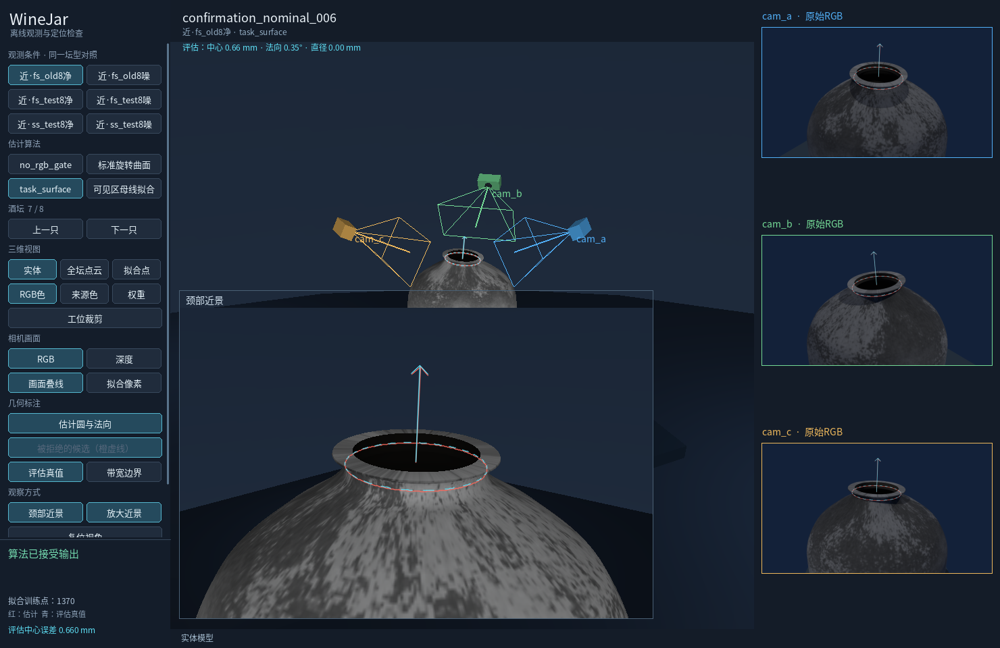

# 工程接手：作业区验证与误拒绝

2026-10-28。离线；无真实采集、设备连接、机器人操作、训练、提交或推送。

## 接手结论与优先级

完整复核10-27工程任务书及几何能力/成熟方法报告；模型、原始IR/RGB、分割缓存、预测与两个原MuJoCo查看束均存在。独立`mujoco_xarm6/`工作区干净、未改。当前GPU为RTX4050 Laptop 6GB，开始时无其他模型进程；沿用隔离的FS venv、winejar-vision与winejar-stereo，不改环境或安装依赖。

10-26“深度形变是主因”的结论是当时冻结链路诊断，不覆盖10-27之后的成熟方法适配成果。近距中心4mm现在有强仿真证据，当前工程优先级是：

1. 分清好估计被错误验证拒绝与真正几何错误；避免用上下文拟合偏差否决作业目标。
2. 分开中心/方向/尺寸、原生接受、3mm带轴向包含和真实扎口，不将中心精度当工艺保证。
3. 准备实物独立计量与真实可用槽区间定义；继续在同一合成族上堆高通过率不能证明可部署。

## 本轮选中的具体失效

已看旧8例，FS+SAM2的`confirmation_nominal_006/clean`：中心0.660mm、法向0.348°，仍被拒绝。重新投影实际保存的拟合曲面后：

| 相机 | 整段曲面最大越界px | 最坏点相对目标轴向位置mm | 目标附近3mm曲面最大越界px |
|---|---:|---:|---:|
| A | 0.121 | +8.55 | 0 |
| B | 2.051 | −9.25 | 0 |
| C | 2.395 | −9.25 | 0 |

触发点位于远离作业位置的上下文。完整局部模型的轴对称近似、曲线端点和分割都会影响这里；本轮没有进一步把这三个因素唯一分开。已确认的是：拒绝证据并不发生在目标作业曲面。

## 成熟方法依据与适配范围

查阅[PCL全局假设验证官方教程](https://pcl.readthedocs.io/projects/tutorials/en/master/global_hypothesis_verification.html)：它把拟合假设与场景验证分开，显式处理模型支持、遮挡与杂波。直接移植要求可靠的物体模型及对应解释，本项目没有每只坛的精确CAD，不能默认上下文全都服从局部回转模型，因此不整套引入GHV。

[Laurentini团队的visual hull说明](https://cgvg.polito.it/vhull.html)给出了轮廓体交及其信息边界。由此可知：正确目标表面投影应在整坛轮廓内，但“在里面”不足以证明位置/方向准确，尤其不能恢复轮廓未约束的内部凹颈。这是已有几何依据，不是本轮提出的新方法。

本轮工程推断是：硬验证应针对实际声称已估准的作业区域；把不保证精确的上下文曲面保留为诊断，而不让它单独否决目标。该推断必须接受错误放行与候选重排的检验。

## 改了什么，没有改什么

新增`neck_localization/task_surface_validation.py`，在同一初值、同一选点和同一次冻结拟合上比较三种验证：

- `visible_profile`：原整段有限曲面验证。
- `task_surface`：仅对以候选圆为中心、沿候选轴宽3mm的拟合表面做硬包含检查；端点精确采样，不向保存曲线范围外插。
- `no_rgb_gate`：完全删除RGB验证，仅作为消融负对照，不作部署候选。

2px门槛、全部非RGB拒绝规则、深度残差、轴参数边界及原整段投影的排序分数均不变。每个初值分别重新验证，之后按各自接受状态和同一原分数选候选，未按真值选圆。整段检查另存为`context_surface_projection`，作业区检查为`task_surface_projection`。第四个对照是原标准SOR，未改参数或实现。

这个3mm表面段是图像支持检查，不是带材本体/厚度/碰撞模型，也不是实际可用槽区间估计。原冻结模块、SAM/FS模型、查看器和默认方案均未改。

## 冻结与数据

- 开发：已看12+旧8，共20只坛；两前端、clean/shared_noise两条件，320条正式配对记录。
- 测试：固定seed2026102809的新8只常规坛，同一圆截面族/近距布局，128条。没有按结果重采、删除或调参。
- 新算法代码先于新配置生成；正式方法散列冻结在渲染启动后、任何新对象双目/分割推理与评价前完成。未把这个时间点说成“渲染前冻结”。源文件随后逐项不变。
- 三机同一对保存IR分别输入FS与SimSense，FS官方完整预训练权重/32次细化；SAM2 tiny按原固定RGB协议，无训练。新48对FS、48对SimSense、24张SAM均完成。
- 新几何/纹理独立，但仍沿用既有噪声种子规则；两个噪声条件不是16只独立坛或大量噪声重复采样。
- 每组四个结果返回后才读真值，评价文件不进入估计器。全部448行、失败及异常保留。各正式目录输入/源码验证通过，异常0。

## 效果与不利结果

开发中原有FS误拒恢复：旧8/clean接受7→8，圆心与法向不变。开发全部80组中，没有新增中心超4mm的接受；但候选重排不是无害的：旧12 SimSense/clean `structural_test_nominal_002`中心2.336→2.299mm、法向1.312→1.430°，轴向带由包含变为越界0.055mm。该回退保留，不以中心略好掩盖。

### 新8独立同族测试

以下两种验证在新8的预测及接受结果完全相同，因此同列；每行分母8。方向2°、直径2mm仍只是研究指标，厂方只确认中心4mm/优选3mm。

| 前端/输入 | 接受 | 中心：中位/P95/最大mm | 法向最大° | 直径最大误差mm | 中心误拒/错误接受 | 带轴向包含 |
|---|---:|---|---:|---:|---|---:|
| FS clean | 8 | 1.768 / 2.578 / 2.670 | 1.505 | 1.499 | 0 / 0 | 7 |
| FS shared | 8 | 1.704 / 2.638 / 2.660 | 1.502 | 1.898 | 0 / 0 | 6 |
| SimSense clean | 8 | 1.613 / 2.777 / 2.986 | 1.361 | 8.996 | 0 / 0 | 7 |
| SimSense shared | 8 | 1.620 / 2.754 / 2.911 | 1.304 | 8.998 | 0 / 0 | 7 |

按中心4mm+方向2°的暂定联合口径，新8也无误拒或错误接受；按完整圆的直径2mm口径，SimSense仍有尺寸超差。不能混写这些结论。

标准SOR强对照：新8 FS两条件中心最大2.813/2.786mm，法向最大1.961/1.699°，带均7/8；SimSense中心最大2.837/3.001mm、法向1.068/1.152°、带均7/8。FS噪声条件的带表现好于区域法的6/8。没有证据本轮候选普遍优于标准SOR。

### 工艺与最终扎口

新`confirmation_nominal_001`在两个前端、两种几何后端、两输入条件下均有带轴向越界，不能只挑一个FS失败作论据。FS作业区法clean：中心2.406mm、法向1.244°均达标，但真实轴向中心偏−2.245mm，倾斜摆幅1.250mm，加半带宽1.5mm，使8.068mm标注颈段越界0.961mm。

这只是模型的轴向几何包含。未检验真实接触、径向间隙、带厚、收紧/滑移、扣头、输送误差或工具路径。**工艺可用性仍未验收，最终扎口未执行；不能报告扎口成功率。**定位层接受不应直接作为执行许可。

### 是否只是删掉门槛

固定负控：对每个clean保存候选分别平移X+150mm、Y+150mm或半径×3，共168个验证器压力样本。原版及作业区版均拒绝168/168，删除RGB门槛则接受168/168。原3mm支持外插和非RGB拒绝亦有单测。

这些是故意保留原深度拟合状态、只污染假设模型的**验证器单独测试**，不是重新运行全流水线的168个错误接受样本，不能当作真实产线错误放行率。

## 取舍

**保留作业区验证为可选工程候选/诊断，不替换默认方案。**它修复一类已证实误拒，并保留对明显图像矛盾的约束；但新8没有额外收益，开发候选重排还出现小幅带回退。不能因接受更多就宣布完成优化，也不能把它作为工艺放行器。

下一项高价值工作应先定义实物可用槽区间及独立测量：确认约6mm物理颈是否全部可放3mm带、需要何种余量，再评价普通曲面/标准SOR/当前候选的“可用放置集合”。中心定位继续保留成熟强基线。实际节拍、允许观测帧数、带材/工具几何、参考计量与输送到位误差未确认；本轮不虚设部署阈值。

## 原MuJoCo查看与复现

旧默认束完全保留。新对照用原命令显式指定查看束：

```bash
conda run --no-capture-output -n winejar-stereo \
  python /home/wunicheng/Git/WineJar/scripts/view_structural_study.py --ground-truth \
  --viewer /home/wunicheng/Git/WineJar/experiments/neck_localization/results/task_surface_viewer_20261028_v1 \
  --condition close/fs_old8/clean --case confirmation_nominal_006 --method task_surface
```

点“可见母线拟合”看原拒绝，点`task_surface`看修复；`no_rgb_gate`仅消融。`fs_test8`/`ss_test8`是新8而非旧8，条件按钮切clean/noise。查看新带失败用`close/fs_test8/shared_noise`、`confirmation_nominal_001`，再开带宽边界。



固定输入重跑示例，输出必须为新目录：

```bash
cd /home/wunicheng/Git/WineJar
OPENBLAS_NUM_THREADS=1 OMP_NUM_THREADS=1 conda run --no-capture-output -n winejar-stereo \
  python scripts/run_task_surface_study.py \
  --manifest experiments/neck_localization/runs/engineering_target_surface_20261028_v1/inputs/manifest_locked_test.json \
  --predictions experiments/neck_localization/runs/engineering_target_surface_20261028_v1/foundation_stereo \
  --foreground-cache experiments/neck_localization/runs/engineering_target_surface_20261028_v1/sam2/manifest.json \
  --freeze experiments/neck_localization/configs/engineering_target_surface_20261028_v1_method_freeze.json \
  --role repeated_locked_test_not_new_independent_evaluation \
  --output experiments/neck_localization/results/MY_task_surface_replay --workers 2

conda run -n winejar-stereo python -m unittest discover -s tests/neck_localization
```

汇总：`results/task_surface_engineering_20261028_v2/`，448完整记录、分组连续误差/误拒/错误接受、变更案例、160条旧基线重放和168负控。以上results相对`experiments/neck_localization/`。
六个正式目录分别为`task_surface_development_{fs12,ss12,fs8,ss8}_20261028_v1`及`task_surface_locked_{fs8,ss8}_20261028_v1`。新大输入/模型预测在`runs/engineering_target_surface_20261028_v1/`，渲染在`runs/engineering_target_surface_render_20261028_v1/`，迁移须一起携带或按协议重建。

验证：134单测中132通过、2默认GL跳过；160条旧基线决定一致，最大位置重复差约2.44e−11m、单位法向差2.11e−10。统计脚本初用1e−10数值容差被极小法向舍入触发，v1中止保留；v2改为1e−9数值复核容差并保存各差值，**未改变任何算法/验收阈值或测试预测**。原查看器实际GL核查6条件×4方法、四张截图和保护源散列通过，全部窗口已关闭。

计时：配对算法共用拟合，记录中各方法时间不宜当独立部署延迟；FS每对新IR约2.3s，三视串行仅双目部分已约7s，未确认工位节拍前不称实时达标。未做部署速度优化。
