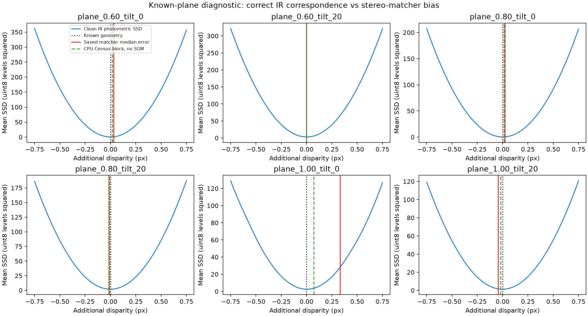

# 主动双目平面误差诊断（2026-10-24）

**结论：本批 1 m 平面的约 −15 mm 误差已定位到 SimSense 匹配过程；没有证据表明它是实际 D435i 的误差幅值。**
保存的左右 IR 图中，正确视差与已知平面几何一致；默认匹配器却偏向最近整数视差。
关闭内部 IR 噪声和中值滤波后偏差仍在。公开实现的 Census/SGM 代价与三点抛物线亚像素插值是当前主要怀疑环节，
尚未把 SGM 与亚像素插值各自贡献完全分离，不能称为已证明的单一源码缺陷。

## 做了哪些检查

输入是 `runs/active_stereo_planes_20261024_v2/` 的六对保存 IR、原生深度和独立理想深度；没有重渲染。
诊断 ROI 为左 IR 图 `y=[160,320), x=[300,550)`，每例 40000 点。
已知几何只用于本节诊断，不进入酒坛定位器。

1. **核对双目几何。** D435 预设左右 IR 同姿态，基线 50.157193 mm；垂直和前后方向残差小于 1e−10 m，
   `rectified=True` 合理。焦距 430.139801 px，使用 (d=fB/z_{left})，不混用斜距或 RGB 光轴深度。
2. **独立核对图像对应。** 根据理想深度计算每个像素的正确视差，对右图进行浮点线性插值，
   再扫描额外视差 −0.75 至 +0.75 px，步长 0.005 px。六例 SSD/NCC 的最优增量均为 0 至 0.005 px，
   NCC 峰值均大于 0.999。OpenCV `remap` 的 1/32 px 插值表未用于这项亚像素检查。
3. **CPU 机制对照。** 重现公开源码的 7×7 中心对称 Census、7×7 块代价和三点抛物线，
   暂不加入 SGM、内部噪声、中值或左右一致性检查。它已存在整数锁定倾向，幅度弱于完整引擎。
4. **上游匹配器消融。** 单引擎依次重放 6 例×内部噪声开/关×中值尺寸 1/3，共 24 次。
   不运行光线追踪，不更改原定位代码。

## 关键数字

下表均为左 IR ROI 的光轴深度误差，未经过 Z16 量化或 RGB 配准，单位 mm。
与原平面验证表中 RGB ROI 的法向距离统计口径不同，不能逐项直接相减。

| 距离、倾角 | 保存原生输出均差 | 关闭 IR 噪声，保留中值3 | 关闭噪声和中值 | 保存原生输出 RMS |
|---|---:|---:|---:|---:|
| 0.6 m，0° | −0.513 | −0.513 | −0.514 | 0.989 |
| 0.8 m，0° | −0.723 | −0.725 | −0.725 | 1.371 |
| 1.0 m，0° | −14.176 | −14.441 | −14.418 | 14.727 |
| 1.0 m，20° | +1.502 | +1.314 | +1.316 | 8.038 |

1 m、0°时正确视差中位数为 **21.5763 px**，保存匹配器结果为 **21.9208 px**，接近整数22；
平均视差误差为 +0.3107 px。干净 IR 的独立光度匹配最优增量仅 +0.005 px（SSD）/0 px（NCC）。
CPU 无 SGM 对照平均视差误差为 +0.0666 px；完整匹配器关闭噪声后仍为 +0.3165 px。
因此，错误已在原生匹配结果中出现，Z16、空间滤波和 RGB 配准不是它的必要原因。

**重放一致性：** 每组消融从原 seed 新建匹配器，按原六例顺序输入。
默认噪声＋中值3的六张完整原生深度，与原 `.npz` 逐像素完全相同，最大差为0。
这验证了本批 PNG 量化输入与原 CUDA 浮点图先转 uint8 的输入等价；未把这种等价推广到别的图像或版本。
无噪声条件只关闭匹配器内部 gamma/thermal 噪声；图像仍含原有 RT 采样/去噪结果，不能叫无限精度光学真值。

## 如何解释，下一步如何用

RealSense 官方资料明确说明亚像素整数锁定、半视差跳变可造成小平面拟合 RMS 却存在绝对偏差，
并区分这种非线性与整体标定斜率/偏移；其 A-factor 是实际 D4 算法参数，不是本 SimSense 实现已有的等效补偿。
官方文献报告的幅度和硬件条件不能直接赋给当前模拟器。

本批三个正对平面的视差恰好分别接近36、27和21.6，不能只用三个距离拟合固定偏移或尺度后宣布解决。
倾斜平面的视差跨越更多相位，正负误差可能互相抵消；它的均差变小而 RMS 仍大，也不能视为精度恢复。
建议继续把 SimSense 用作**机理驱动、尚未经本机数据校准的压力模型**，并以独立平面距离/视差相位扫描检验它的非线性。
酒坛上的真实材料红外响应、机内标定/温漂以及多发射器干扰均未由本检查验证。

图中黑虚线为正确几何，蓝线最低点为干净 IR 支持的视差，红线为保存匹配器的误差中位数；
1 m 正对平面的红线明显偏离最低点。



## 复现与证据

```bash
cd /home/wunicheng/Git/WineJar
OPENBLAS_NUM_THREADS=1 OMP_NUM_THREADS=1 \
conda run --no-capture-output -n winejar-stereo \
python scripts/analyze_active_stereo_planes.py \
  --input experiments/neck_localization/runs/active_stereo_planes_20261024_v2 \
  --output /tmp/winejar-plane-diagnosis-NEW \
  --replay-matcher
```

输出目录必须不存在。去掉 `--replay-matcher` 则只做 CPU 诊断。
脚本为 `scripts/analyze_active_stereo_planes.py`。
结果目录 `experiments/neck_localization/results/active_stereo_plane_diagnosis_20261024/` 包含
`summary.json`、光度搜索完整曲线、ROI视差数组、24项匹配器消融、默认重放逐图差值和输入散列。
这些是已知平面诊断，不是酒坛测试集成绩，也不是实际相机绝对精度验收。

## 公开原始来源

- [RealSense 亚像素线性白皮书](https://dev.realsenseai.com/docs/white-paper-subpixel-linearity-improvement-for-intel-realsense-depth-cameras/)：
  整数锁定、半视差、RMS与准确度的区别及 A-factor。
- [SAPIEN 固定 revision 的子模块记录](https://github.com/haosulab/SAPIEN/tree/8360d517770f24f00bacef7d906ddf1380b8967c/3rd_party)：
  指向 SimSense `8ab7719390bcb3bfb585368538b4f55bfa0e5456`。
- [SimSense winner-takes-all／亚像素源码](https://github.com/haosulab/simsense/blob/8ab7719390bcb3bfb585368538b4f55bfa0e5456/src/wta.cu)：
  整数代价最小值及三点抛物线插值。
- [SimSense 总流程源码](https://github.com/haosulab/simsense/blob/8ab7719390bcb3bfb585368538b4f55bfa0e5456/src/core.cu)：
  浮点RGBA首通道转uint8、IR噪声开关、块代价、四方向SGM、中值、深度计算及配准。
- [SimSense IR 噪声与深度源码](https://github.com/haosulab/simsense/blob/8ab7719390bcb3bfb585368538b4f55bfa0e5456/src/camera.cu)：
  gamma乘性噪声、加性噪声和 (z=fB/d)。本机包的默认噪声量级来自 `simsense_component.py`，未拟合实机。

公开源码用于解释机制；wheel 内核的完整编译溯源尚未独立重建。当前可执行行为以保存输入、逐像素重放和消融结果为证。
