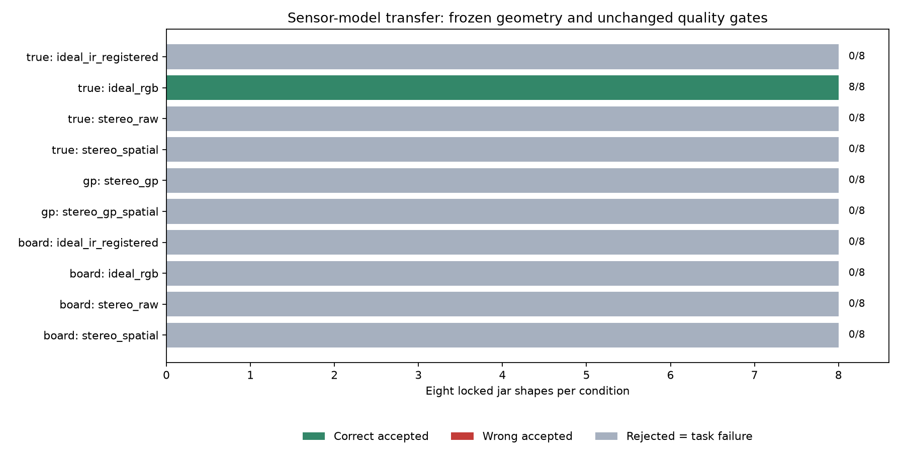

# 成熟传感器模型、标定与补偿：实施结果

2026-10-25。全程离线；没有连接设备、改变实机配置、提交或推送。

后续补充：[鼠标导航、颈部后处理消融与拟合选区核查](viewer_and_support_audit_20261025.md)。
下文保留本轮原结果，查看器交互以补充报告为准。

**已经把讨论的方向落实为可复现对照，但尚未解决真实深度条件下的定位。**
8个新坛型在理想RGB深度下正确输出8/8；换成主动双目深度后为0/8，
官方空间滤波和本次论文GP校正均未改善。拒绝全部计作任务失败。
这揭示了理想几何实验与成像测量之间的差距，不能解释为现实D435必然失败。

## 具体增加了什么

| 新增项 | 实际实现 | 作用与边界 |
|---|---|---|
| 机制驱动的主动双目 | 同一酒坛OBJ/贴图→SAPIEN红外投影与左右IR成像→SimSense Census/SGM/亚像素匹配→原生左IR光轴深度 | 深度错误由图像匹配产生；不是在理想点云上统一加高斯噪声 |
| 官方后处理 | 原生Z16→视差→librealsense空间滤波→深度→官方RGB对齐，并换算为RGB光轴Z | 单帧；不使用时间滤波、额外补洞或真值填补 |
| 独立平面GP补偿 | 移植Heindl作者的ARD-RBF GP；以测量XYZ和固定温度为特征，学习参考Z−测量Z | 119帧已知平面观测，按距离/姿态划分训练/验证/测试；酒坛及其真值不参与训练 |
| 图像求标定参数 | 63张实际棋盘RGB→SB角点→calibrateCamera→固定世界参考面solvePnP | 真K/T不初始化求解；目前只估RGB参数，IR与内部RGB–IR变换仍准确 |
| RGB输入适配 | 根据真实RGB的蓝背景色差提取完整前景，保留暗颈；冻结几何与质量门槛 | 解决更换渲染器后的提取迁移问题；不是通用分割器，仍有边界偏移 |
| 失败可视化与审计 | 保存实际RGB、深度、图像掩码、实际拟合点及拒绝原因；MuJoCo近景/点云查看 | 无完整预测时不画假圆；真值只在显式G/--ground-truth时显示 |

选择依据是[主动双目原论文与项目](https://angli66.github.io/active-sensor-sim/)、
[当前D435预设源码](https://github.com/haosulab/SAPIEN/blob/8360d517770f24f00bacef7d906ddf1380b8967c/python/py_package/sensor/stereodepth.py)、
[RealSense官方滤波](https://github.com/realsenseai/librealsense/blob/master/doc/post-processing-filters.md)、
[GP作者实现](https://github.com/cheind/rgbd-correction/tree/3b2eb5d3dea0e34a3e37a15cea376e1e061c3bc4)
及[OpenCV官方标定接口](https://docs.opencv.org/4.x/d9/d0c/group__calib3d.html)。
Basso完整RGB-D联合标定仍是参考路线，本轮没有移植其ROS/PCL/Ceres系统，不能称已复现。

## 实验条件与隔离

4开发坛型、另锁8测试坛型，分别为2+2和4+4常规/压力例；
种子2026102453/2026102457，传感器噪声种子2026102451。
仍为圆截面、照片参考的假设模型族，颈长事先设置不小于6.2mm；尺寸分布不是工厂统计。
相机固定为0.8m、方位−50/50/180°、俯视10/10/8°；没有布局搜索。
新后端使用D435预设RGB/IR内参，不再沿用早期统一50°视场作为测量参数。

世界米制、+Z向上；相机OpenCV右/下/前；T_world_from_camera将相机点变到世界。
深度是光轴Z，不是射线距离。SAPIEN像素角原点K转数组整数中心K时主点减0.5。
RT Position记录最后一条Halton子像素射线，不能作像素中心真值；理想深度由独立raster中心射线获得。
已知倾斜平面核查误差<0.001mm只是坐标/数值诊断，不是任务精度承诺。

预先冻结传感器、几何和RGB适配代码后评价8新坛型。
几何主对照为既有V2目标范围验证组合，**没有自动叠加旧三常数偏差求解器**；
否则会同时改变传感器与估计结构，难以定位退步原因。
旧灰度提取器的结果另保留，理想深度仅2/8，属于输入迁移问题，不当作几何方法理论极限。

条件名对应实际输入：

| 条件 | 深度来源 | 相机参数 |
|---|---|---|
| ideal_rgb | RGB中心射线理想深度；理想诊断 | 准确K/T或另列棋盘估计K/T |
| ideal_ir_registered | 左IR中心射线理想深度→1mm单位Z16→官方RGB对齐；理想诊断 | 同上 |
| stereo_raw | 主动双目匹配→Z16→RGB对齐 | 同上 |
| stereo_spatial | 同一匹配深度，先做官方视差域空间滤波 | 同上 |
| stereo_gp / stereo_gp_spatial | 锁定GP先校正原生浮点深度，再量化/可选滤波/对齐 | 准确K/T |

棋盘参数对照保持已保存的RGB注册深度不变，只替换定位器的RGB K和世界外参；
注册过程仍用准确内部参数，并未完成“估计参数贯穿全部RGB-D注册”的实验。
1mm深度单位、噪声默认值、材料红外响应都是明确假设，未按现有D435i测定。
各相机依次独立投影采集，未模拟多投影器干扰。照片颜色不能证明红外反射率。
每例只有一次固定种子的噪声实现；8个坛型的比例不是长期噪声成功概率，
也未覆盖全部光照/曝光/温度/材料条件。相机信任系数均为1，不按相机点数强行平衡总权重。

## 八坛型锁定结果

成功定义：接受且圆心≤4mm、法向≤2°、直径≤2mm；后两项仍为建议分析阈值。
整带还要求3mm带位于模型标注的近最细区间，不能称实机作业成功。
法向统一指向上方n_z>0，角误差为arccos(n_est·n_true)，不忽略符号。

| 参数/深度 | 正确输出 | 拒绝 | 错误接受 | 已形成完整候选圆 | 拟合耗时中位/P95/最大 ms |
|---|---:|---:|---:|---:|---:|
| 准确/ideal_rgb | 8/8 | 0/8 | 0/8 | 8/8 | 135 / 213 / 216 |
| 准确/ideal_ir_registered | 0/8 | 8/8 | 0/8 | 5/8 | 1447 / 2275 / 2533 |
| 准确/stereo_raw | 0/8 | 8/8 | 0/8 | 0/8 | 1180 / 2189 / 2287 |
| 准确/stereo_spatial | 0/8 | 8/8 | 0/8 | 0/8 | 1611 / 2796 / 3236 |
| 准确/stereo_gp | 0/8 | 8/8 | 0/8 | 0/8 | 1309 / 2354 / 2358 |
| 准确/stereo_gp_spatial | 0/8 | 8/8 | 0/8 | 0/8 | 1112 / 2959 / 3258 |
| 棋盘估计/ideal_rgb | 0/8 | 8/8 | 0/8 | 6/8 | 1171 / 2001 / 2328 |
| 棋盘估计/ideal_ir_registered | 0/8 | 8/8 | 0/8 | 5/8 | 1361 / 1839 / 1928 |
| 棋盘估计/stereo_raw | 0/8 | 8/8 | 0/8 | 0/8 | 1724 / 2263 / 2313 |
| 棋盘估计/stereo_spatial | 0/8 | 8/8 | 0/8 | 0/8 | 1232 / 2544 / 2839 |



几何误差统计包含拒绝但已经形成的圆，**无圆不记为零误差**：

| 条件及统计样本数 | 圆心 mm 中位/P95/最大 | 法向 ° 中位/P95/最大 | 直径 mm 中位/P95/最大 |
|---|---:|---:|---:|
| 准确/ideal_rgb，8 | 0.471 / 1.082 / 1.106 | 0.010 / 0.101 / 0.128 | 0.011 / 0.034 / 0.036 |
| 准确/ideal_ir_registered，5 | 0.139 / 1.247 / 1.328 | 0.171 / 0.533 / 0.599 | 0.765 / 0.832 / 0.838 |
| 棋盘估计/ideal_rgb，6 | 0.625 / 0.726 / 0.730 | 0.311 / 0.863 / 0.895 | 6.188 / 6.389 / 6.439 |
| 棋盘估计/ideal_ir_registered，5 | 0.751 / 0.895 / 0.919 | 0.795 / 1.525 / 1.630 | 7.043 / 7.161 / 7.178 |

理想RGB的8例整带均包含；圆心误差主要沿轴向，法向分量绝对值中位/P95/最大0.471/1.082/1.106mm，
切向0.00081/0.00735/0.00740mm。逐例XYZ有符号误差保存在原记录，完整统计见
`experiments/neck_localization/results/active_stereo_summary_20261025/{summary.json,summary.csv,cases.csv}`。
脚本只汇总记录，不改变估计。无完整圆的条件无法报告圆误差分位数；局部轴/拟合点仍保留供诊断。
本轮没有校准完整圆环置信区间，GP条件方差也不冒充任务置信度。

上述耗时仅几何推理，不含渲染、I/O或GP预处理；GP每张原生图约2秒，三机另需约6秒，尚无受控工位SLA。
理想条件快速返回、失败条件尝试多个备用解，不能把耗时差全归因某个优化器。

## 失败已经解释到哪一步

**一、理想IR注册已经使门槛失效，不能只怪双目噪声。**
5个完整候选圆实际几何在暂定阈值内，却因核心/目标读出一致性被拒绝；其余3例未形成完整圆。
这提示采样、Z16量化、对齐后的相关点和理想条件门槛不兼容。
补充的[原生IR点对照](native_stereo_diagnostic_20261025.md)只用4个开发例：
保留IR原生点，仅投影真实RGB颜色/图像掩码，浮点理想及同样1mm量化均4/4正确；
量化版最大圆心0.568mm、法向0.129°、直径0.058mm，原生主动双目/空间滤波仍均0/4。
这支持优先保留原生几何，但两流程点密度、采样位置、可见性也不同，不能只归因某个SDK实现细节。
未放宽门槛；有2例原生双目口沿种子仅48/56票，卡在原60点门槛，
RGB注册可把票数抬高却不增加独立信息。后续支持判断需考虑面积、覆盖及信息，不能只数重采样点。

**二、双目匹配误差不是独立随机点误差。**
独立平面的相邻像素误差相关系数横向0.947–0.992、纵向0.990–0.996。
六对保存IR逐像素重放可精确复现原生深度；1m正对平面ROI约−14mm偏差，关内部IR噪声/中值后仍约−14mm。
正确光度匹配支持几何真视差，现匹配器则靠近整数视差。
证据指向匹配代价/SGM/亚像素环节，尚未完全分离；详见[专项诊断](active_stereo_plane_diagnosis.md)。
这个数值不能赋给真实D435i，也不能把仿真器的局限当创新结论。

**三、平面GP没有学到有用校正。**
93训练、14验证后锁模型，再测12平面，RMSE 4.285→4.300mm、P95 8.926→8.944mm；
校正前后有效点不变，没有通过校正时删点制造改善；标定mask已预筛有效测量，不能代表整个传感器覆盖率。
GP信号幅度缩到下界，近似加0.369mm常数。
仅测量XYZ和固定T的特征未覆盖纹理/方向/边界/匹配上下文；但本次尚未分离特征不足、
512点稀疏训练及单超参数初值各自的贡献，也没有注入真实单机空间标定畸变，不能推断GP普遍无效。
本轮不把它设为默认。详见[模型与隔离说明](depth_correction_adapter_notes.md)。

**四、标定残差小仍可能三维偏。**
63张实际图全部检出；三机重投影RMS约0.099px，相机位置误差仍3.818–3.967mm，焦距约偏+0.52%。
在本任务中准确参数的8/8变成估计参数0/8；理想深度候选直径最多偏6.439mm。
固定世界夹具、板尺寸/平面度仍理想，IR内部参数仍准确；这不是完整标定不确定性预算。
详见[棋盘方法、图像及调试记录](rendered_calibration_stage1.md)。

**五、简单RGB轮廓替代没有直接奏效。**
参考旋转曲面论文实现了三视图轮廓切线反投影与局部轴/母线联合拟合，4开发例0/4。
真实深色颈部掩码内缩、口沿边缘混入及微分误差放大均存在；GT轴诊断仍有半径偏差。
它不是原论文完整图像空间优化的复现，不据此否定RGB路线。
详见[有来源的原型与失败图](silhouette_depth_independent_baseline.md)。

## 现在的误差分工与下一步

| 类别 | 当前证据 | 合适的独立约束/处理 |
|---|---|---|
| 世界外参、RGB内参、RGB–IR参数及尺度 | 仅RGB棋盘参数已实际求解；其余未全面估计 | 独立米制板/夹具、多距离多倾角、RGB-D联合标定，再用独立三维检具验收；不让坛形状吸收全局尺度 |
| 匹配相位、纹理、遮挡边界及空间相关 | 原生深度重放和消融已证实此仿真存在 | 检验匹配可用性和原生点表示，按匹配支持建权重/相关模型；Huber降低大残差影响，但不显式描述相关/共享误差，也不保证排除低残差伪面 |
| 暗颈RGB边缘、局部形状和区域端点 | 蓝键迁移已修一部分，轮廓仍偏；圆家族限制未移除 | 图像空间投影约束、可见性与区域联合优化；后续加非圆/局部形变独立测试 |
| 输送到执行工位 | 只知坛相对传送带姿态不变 | 独立测工位变换、位移/编码器、滑移和TCP；不能让视觉残差网络凭空恢复不可观测世界偏差 |

这些误差可以在同一概率模型或网络中联合处理，分来源是为了提供可识别信息和验收依据，并不要求拆成三个网络。
本轮未训练RL；直接把所有残差交给网络，仍需合适的监督或奖励（可以来自仿真/任务），
并用独立真实参考检验跨坛型/距离/设备迁移及错误接受。

优先顺序是：在已完成的4开发例原生点诊断上扩展独立验证、审计RGB边界和颈部可见性；
再在图像/视差空间加入前向成像约束，避免把每个相关深度点都当作精确独立表面点。
在约0.8m、IR焦距约430px时，6mm竖直颈段只有约3.2个像素；7px匹配块约跨13mm，
Census和块组合影响范围还会更宽。这是采样量级估算，**不是当前布局无解的证明**。
要先核对颈段哪些像素可见、是否被跨区域混合，随后再按用户要求作布局信息分析；不直接开启位置搜索。

可推广的问题候选是：**有限视角RGB-D中，当深度匹配支持跨越窄结构边界时，如何联合估计局部轴、
半径曲线与可信支持，使有限宽度环带可靠落入可用区域？**
现有文献已经有联合几何、轮廓和传感器校正；本轮只形成可复现实验问题，未证实新颖性或论文贡献。

后续获准实机实验时，应先采独立平面/台阶/圆柱的多距离多入射角RGB+左右IR+原始深度，记录模式、
曝光、投影器、温度和深度单位；用独立测量参考区分尺度、相位、材料和标定误差，再检验此仿真器是否适用。
最后用独立测得的槽区间、中心/法向/直径及3mm整带余量验收，包含固定与相关误差，不能只重复平均。
当前工厂完整成功率目标尚未验证，模拟0/8也不能当作真实设备性能预测。

## 怎么看、怎么复现

以下命令从`/home/wunicheng/Git/WineJar`运行。新环境为`winejar-stereo`，原控制/视觉/embodied-sim环境未更改。
固定依赖见`experiments/neck_localization/requirements-active-stereo.txt`；本机NVIDIA RTX4050，需Vulkan/OptiX。
MuJoCo保留场景与查看器；主动双目来自SAPIEN，同一网格/位姿，不谎称MuJoCo原生深度就是RealSense测量。

新机器可用`conda create -n winejar-stereo python=3.12 pip`建立隔离环境，随后
`conda run -n winejar-stereo pip install -r experiments/neck_localization/requirements-active-stereo.txt`。
GPU驱动/Vulkan/OptiX仍是独立系统依赖，不能只安装Python包就保证渲染可用。

```bash
# 看真实输入、点云与失败；G真值，D深度，L实际拟合点，方向键换8坛型
conda run --no-capture-output -n winejar-stereo python scripts/view_active_stereo.py \
  --condition stereo_raw --ground-truth

# 同一坛型的理想深度成功对照
conda run --no-capture-output -n winejar-stereo python scripts/view_active_stereo.py \
  --condition ideal_rgb --ground-truth

# 棋盘估计参数；其余条件名见上表
conda run --no-capture-output -n winejar-stereo python scripts/view_active_stereo.py \
  --parameters board --condition ideal_rgb --ground-truth

# 原生IR点诊断，单独4开发例；右侧是RGB→IR取色图，不是原相机RGB
conda run --no-capture-output -n winejar-stereo python scripts/view_active_stereo.py \
  --condition native_ideal_z16 --ground-truth

# 一键重新渲染8坛型、旧基线/RGB适配/GP/棋盘参数，共112条推理记录
# 目录必须不存在；使用已锁定的独立GP和棋盘标定产物
OPENBLAS_NUM_THREADS=1 OMP_NUM_THREADS=1 \
conda run --no-capture-output -n winejar-stereo python scripts/reproduce_active_stereo.py \
  --output experiments/neck_localization/runs/MY_NEW_active_stereo_reproduction
```

一键命令已完整实际运行到`runs/active_stereo_full_reproduction_20261025_v1/`：
112条记录除耗时完全一致，144份RGB/深度输入一致，48组相机元数据一致。
这里只重做酒坛测试；重生成119平面/GP的命令见[GP文档](depth_correction_adapter_notes.md)，
重生成63棋盘的命令见[标定文档](rendered_calibration_stage1.md)。
小型锁定GP、棋盘参数及80条主比较压缩记录已原样复制到
`results/active_stereo_20261025/artifacts/`，附原件路径、字节数和SHA256清单。
一键命令直接用这些小产物，不要求先迁移被忽略的标定runs；大原始观测仍在runs中保留。
`scripts/reproduce_active_stereo.py --check-artifacts`可只核对源码、配置及模型，不渲染。

原始结果：`runs/active_stereo_{adapted,gp_adapted,board_calibrated}_test_20261025_v1/`。
对应观察源为`runs/active_stereo_test_20261025_v1/`，IR和原生深度在`sensor_diagnostics/`，
目标圆及模型标注在`evaluation_only/`；理想深度和sensor_diagnostics中的理想IRZ亦为明确诊断真值。
路径均相对`experiments/neck_localization/`。

原生点查看束是`runs/native_stereo_viewer_20261025_v2/`，科学记录仍在
`runs/native_stereo_development_20261025_v2/`，原件未修改。
48组原生查看相机位姿/内参/848×480分辨率核对，投影最大差4.19e−5px；
`results/native_stereo_viewer_20261025_v2/ideal_z16_pointcloud.png`是实际窗口回读。

审计见`results/active_stereo_20261025/input_validation.json`：80条主比较记录中79条有拟合点，
共125730点逐点与相应保存深度/K/T反投影一致；240组RGB/mask哈希及重新提取一致。
唯一未形成拟合集的棋盘/raw压力例明确记录初始化失败。
20个唯一冻结源、GP模型和棋盘参数hash核对通过，未用mesh采样点混入拟合集。
68项离线测试中66项通过、2项桌面GL默认跳过；另以桌面GL单独运行3项全部通过，覆盖这2项；
包含原生IR新增6项几何/映射检查。仓库文档链接及历史证据散列盘点通过。

**当前判定：理想几何可行性保留；成熟成像/校正对照已落地但抗误差能力未达标；实机有效性未验证。**
