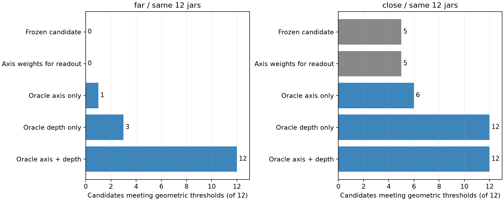
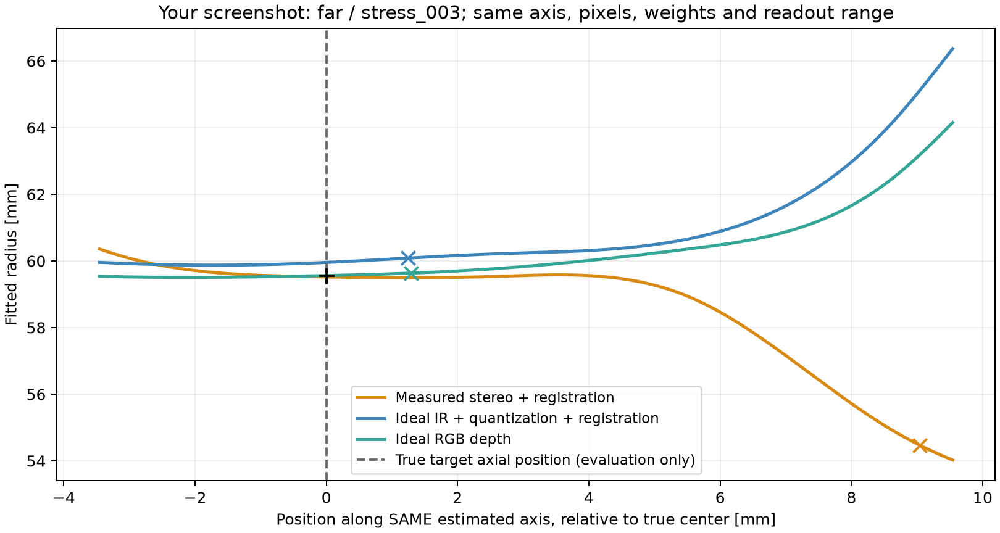
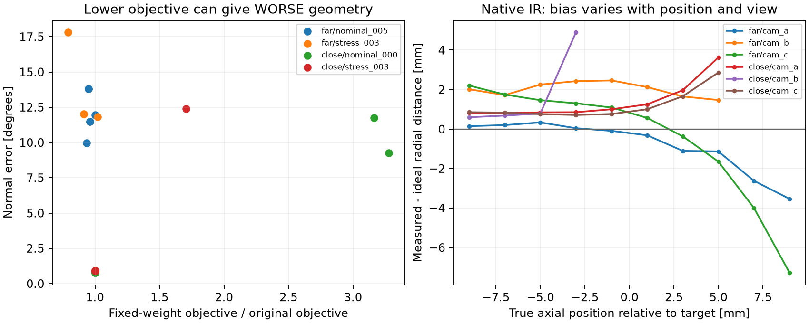

# 本轮失败归因：深度形变、偏轴与目标函数

2026-10-26。仅离线读取既有SAPIEN/SimSense观察，未改定位器、传感器、阈值、查看器或实机配置。

## 结论先读

1. **近距的主要剩余障碍是测量深度改变了半径曲线。**保留原估计轴、原选点像素、权重和读出范围，只替换为同像素理想RGB深度，候选几何达标由5/12变为12/12。仅换准确轴为6/12。
2. **远距同时存在轴线失准和深度形变。**只换理想深度3/12，只换准确轴1/12，两者同时替换12/12。
3. **上轮指出的两套权重不一致不是本批失败主因。**仅让最终读出沿用轴权重，近距仍5/12，远距仍0/12。它是架构疑点，不能继续当作已证实的首要原因。
4. **局部最优确实存在，但不能只靠更充分搜索解决。**4个代表案例的实测点目标函数都更偏好错误轴而非准确轴；截图案例更低的目标值对应17.81°法向误差。固定点/权重的梯度有限差分检查相对差约1e−9，未发现该检查范围内的雅可比错误。
5. **错误不全在RGB对齐。**近距原生IR中36个“坛型×相机”组的径向误差中位数均为正；替换为理想IR再经原量化和对齐，候选达标11/12，接近理想RGB的12/12。但对齐仍会留下误差，不能说无影响。

这里的“达标”只指圆心≤4mm、法向≤2°、直径≤2mm，统计全部候选，不看算法是否接受。**不是成功输出率、不是3mm整带成功，更不是实机精度。**原始双目原算法接受/正确输出仍为0/12；本轮没有提升上线成绩的主张。

## 怎么做的

使用昨天同一12坛型、远近两个固定布局；这些案例已看过，本轮全部是开发诊断，不是新未见测试。

- 原始算法不修改，通过Python返回事件读取已选中初值的运行状态。48次重放：两布局×12坛×理想/原始输入。圆心、法向、半径和拒绝理由与保存结果一致。
- 每例8个固定点池读出干预，共432行（48原结果+384干预）。包含读出精确重放、只换权重、准确轴、同像素理想深度、二者组合及真实外颈支持/搜索范围的oracle诊断。
- 4个代表案例固定最后一次轴权重，每例6个起点、最多400次函数求值，共24次求解；不重新计算区域权重，以免混淆求解器与外层反馈。
- 再做24例的传感器阶段对照，每例三种深度，共72行。三者使用同一原选点像素的共同有效集合、相同原估计轴/权重/网格。
- 另对4例测量/理想同像素XYZ做轴目标函数对照：原样条基、正则项、权重和点数固定，2种XYZ×3起点×4例，共24次求解。
- 未新增渲染、GP、滤波、补偿参数、布局搜索或网络。真值干预明确存在于诊断脚本，不是产品估计器输入。

## 逐项干预结果

以下只比较原始双目条件下同一候选的几何，分母均为12。

| 干预 | 远距几何达标 | 近距几何达标 | 判断 |
|---|---:|---:|---|
| 原冻结候选 | 0 | 5 | 原始候选，不等于接受输出 |
| 读出改用轴权重 | 0 | 5 | 两套权重不是本批主因 |
| 仅准确轴 | 1 | 6 | 深度误差仍在 |
| 仅同像素理想RGB深度 | 3 | 12 | 近距原轴足够；远距偏轴仍阻碍读出 |
| 准确轴+同像素理想RGB深度 | 12 | 12 | 当前选点池中存在可恢复目标的观测支持，但不证明选点已最优 |
| 准确轴+真实外颈标签+真实搜索范围，保留测量XYZ | 2 | 5 | 即使oracle裁点/搜索，也不能消掉深度误差 |
| 上项再改为理想XYZ | 12 | 12 | 诊断上限，绝非可部署方法 |

轴改变时按原规则重新计算全局部点（训练+留出）的2/98百分位搜索界；其他读出干预固定原轴下搜索网格。所有干预固定原读出权重，只有“改用轴权重”一项例外。
这是条件干预，不是全流水线重新初始化/重加权后的效果。



理想RGB原候选远距12/12、近距10/12几何达标，但接受分别7/12、0/12。这与前报告不矛盾：拒绝条件会挡住几何较好的候选，近距还有两例法向超过暂定2°阈值。

## 用户截图stress_003为什么贴口沿

同一个远距案例、同一轴、同一批像素、权重与读出范围：

| 深度来源 | 圆心误差mm | 法向误差° | 直径误差mm |
|---|---:|---:|---:|
| 原始双目+注册 | 9.074 | 0.903 | 10.161 |
| 理想IR+同样量化/注册 | 1.455 | 0.903 | 1.074 |
| 理想RGB深度 | 1.497 | 0.903 | 0.175 |



横轴相对真圆心沿同一估计轴的位置；黑虚线/加号仅评估。橙色原始测量使上方曲线向内收缩，最后在靠口沿的搜索端产生假最小值；蓝/绿理想输入保留了颈部附近的低谷。圆叉表示各自区间中点读出，而非曲线极小点。

该例原始点中76.2%的选中像素，在理想射线标签下确实来自真实外颈。目标附近±1.5mm有261个训练像素。因此不是完全没看到颈部，也不能只归咎选点掺入口沿。
但“真实外颈像素”的测量XYZ已经偏离真实表面，选对像素不等于测到正确三维点。

原生IR按真实轴向位置分箱可见，各相机误差不相同，且随位置改变；某些上部位置会向轴内偏移。这与橙线假谷一致，**不等于已证明具体由某一个匹配内部环节造成**。

## 局部最优与模型目标分别有什么证据

固定原点集和最后一次轴权重：

| 案例 | 原目标值 | 准确轴目标值 | 代表性现象 |
|---|---:|---:|---|
| 远nominal_005 | 476.62 | 836.33 | 多起点可降到445.39，法向仍约9.97° |
| 远stress_003 | 3928.28 | 4261.89 | 更低3114.73对应17.81°；原候选约0.90° |
| 近nominal_000 | 560.88 | 673.21 | 从准确轴出发也收敛回约0.77°偏轴 |
| 近stress_003 | 964.77 | 1060.06 | 从准确轴出发也回到约0.90° |

每行加权目标只宜本行比较，不能跨案例比较其绝对大小。原始4个求解均已success，nfev分别10/7/3/5；400预算的原解重启几乎不变。局部最优有证据，但更低目标不保证物理更准，不能把“找到全局最小”当成充分解法。

同像素理想XYZ进一步隔离传感器影响，保留完全相同样条基与权重：远nominal_005的准确轴目标由836.33降至110.68，原错误轴目标变6817.04；从零/准确轴可收敛到约0.50°，从旧错误轴却停在约12.11°。这里同时有深度改变目标地形和局部极值两个问题。
近stress_003理想XYZ从三起点均到约0.049°；近nominal_000仍约0.50°，说明有限表面范围、过渡/模型与选点造成的残余偏轴没有完全消失。



## 深度误差在哪一段产生

传感器阶段对照使用完全相同的共同有效RGB像素；远距全部保留，近距最少保留99.779%。固定原测量估计的轴，不重新估轴。

| 布局/替换深度 | 几何达标 | 直径误差中位mm | 最大mm |
|---|---:|---:|---:|
| 近/原双目（共同像素） | 5/12 | 2.331 | 8.611 |
| 近/理想IR+量化注册 | 11/12 | 0.630 | 2.148 |
| 近/理想RGB | 12/12 | 0.134 | 1.473 |
| 远/原双目 | 0/12 | 12.900 | 35.430 |
| 远/理想IR+量化注册 | 3/12 | 9.869 | 17.497 |
| 远/理想RGB | 3/12 | 11.720 | 21.016 |

近距原生IR中，36个坛型×相机组的径向误差中位数范围+0.159～+3.247mm；对应光轴Z误差中位数均为负（−4.821～−0.214mm）。这说明原生双目输出已有有方向的形变，不能只修RGB注册。
这些是本次确定种子单帧观测上的分布，不证明真实设备存在同样固定偏差，也没有重复采样来分离永久偏差和随机偏差。

选中RGB共同像素的36组径向误差中位数之中位数，近距原始约+1.149mm、理想IR注册约+0.217mm。
但其合并RMS分别约2.033/2.196mm，后者反而更大：注册边界长尾与主体偏差不同，**不能用一个全局RMS替代任务效果**。两分布有效像素一致，并非删掉坏点后报改善。

原生IR颈段中心线投影长度，远距36组中位6.10像素（3.05～9.66），近距10.83（4.86～19.06）；原配置Census/聚合各7×7。短颈采样和支持窗口跨过渡是值得检验的机制假设，但本轮没有单独关闭各匹配环节，因此不能把误差唯一归因于窗口，更不能把模拟器的偏差当成RealSense实测性能。

## 为什么不能简单剔除非颈部点

真实外颈oracle裁点后，若仍沿用较宽搜索范围，样条在缺少数据的地方可能产生假谷；例如远距某例直径误差可超过200mm。搜索域与有效支持必须一起定义，不能仅减少点数。
用真实颈段裁点并限定真实搜索范围，保留测量XYZ仍只有远2/12、近5/12；同时换理想XYZ才全部达标。Oracle范围还直接携带目标附近信息，只能解释原因，不能作为新方法成绩。
实际估计时需要保留足够上下过渡来界定颈段，同时识别不属于同一局部轴对称表面的分支。

## 下一步范围

优先近距，保留原始输入及远距困难对照：

1. 先分离双目测量形变：在近距工作范围，对平面与已知曲率/短颈分别检查视差相位、匹配支持和曲面边界影响；不先套常数或重新上GP。设置与消融要先固定，不能只调截图病例。
2. 用符合短颈/可见性的观测目标约束深度偏差，避免自由r(s)把偏差解释成真实几何。先做可辨识性分析，防止“增大半径+改深度”互相抵消，不能仅增加自由参数。
3. 远距轴线需要有几何依据的初始化/候选验证；更低残差不能当作更准。区域和曲线读出一致性仍保留检查，但降低其主因优先级。
4. 修正已证伪的RGB轮廓硬门槛；保持正确接受、错误接受、拒绝三类完整报告。不能靠删门槛宣称成功。

本轮完成的是失败归因，尚未验证上述改进。未开展实机工作，未新增部署可靠性结论。

## 复现、产物与检查

仓库根目录执行，以下输出目录必须不存在；依赖已有结构批次输入，无需GPU渲染：

```bash
cd /home/wunicheng/Git/WineJar
OPENBLAS_NUM_THREADS=1 OMP_NUM_THREADS=1 conda run --no-capture-output -n winejar-stereo \
  python scripts/diagnose_structural_failure_chain.py \
  --run experiments/neck_localization/runs/structural_stage_20261025_v1 \
  --output experiments/neck_localization/results/MY_failure_chain

OPENBLAS_NUM_THREADS=1 OMP_NUM_THREADS=1 conda run --no-capture-output -n winejar-stereo \
  python scripts/diagnose_structural_sensor_transfer.py \
  --run experiments/neck_localization/runs/structural_stage_20261025_v1 \
  --output experiments/neck_localization/results/MY_sensor_transfer

OPENBLAS_NUM_THREADS=1 OMP_NUM_THREADS=1 conda run --no-capture-output -n winejar-stereo \
  python scripts/diagnose_structural_clean_objective.py \
  --run experiments/neck_localization/runs/structural_stage_20261025_v1 \
  --output experiments/neck_localization/results/MY_clean_objective

OPENBLAS_NUM_THREADS=1 OMP_NUM_THREADS=1 conda run --no-capture-output -n winejar-stereo \
  python scripts/report_structural_failure_chain.py \
  --chain experiments/neck_localization/results/MY_failure_chain \
  --sensor experiments/neck_localization/results/MY_sensor_transfer \
  --run experiments/neck_localization/runs/structural_stage_20261025_v1 \
  --output experiments/neck_localization/results/MY_failure_report
```

保存产物：

- `results/structural_failure_chain_20261026_v3/`：432完整记录、48例诊断、4组求解器诊断、源码散列与汇总。
- `results/structural_sensor_transfer_20261026_v1/`：72读出记录、144个相机空间诊断组、72个原生文件散列。
- `results/structural_clean_objective_20261026_v1/`：8组测量/理想目标函数对照、24次求解。
- `results/structural_failure_report_20261026_v1/`：三张图与传感器汇总；脚本和输入审计归档于artifacts子目录。

结果路径均以`experiments/neck_localization/`为前缀。v1/v2链路目录是前置脚本检查中止的空目录：先修复condition字段重名，再修复诊断重放误用了训练点百分位而非原代码全点百分位。中止未改任何估计器或输入，正式结果仅v3。

83项离线单测执行，81通过、2项默认桌面GL跳过；新增3项检查精确倾斜圆柱读出、轴坐标规范、异常时恢复Python观测钩子。48次冻结重放和读出重放均有数值断言；与原审计比对960个观测文件散列不变，定位模块源文件散列不变。独立mujoco_xarm6仓库未改。
