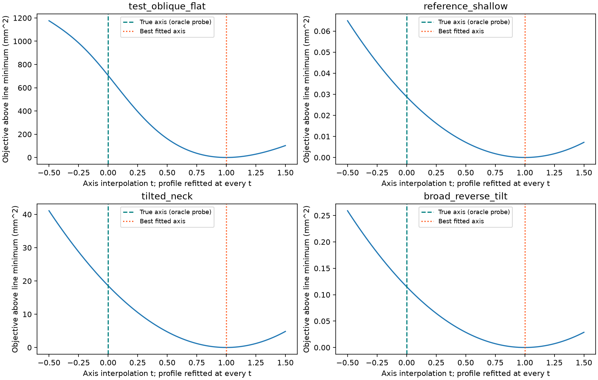

# 联合估计偏差诊断：局部极小与局部模型范围

2026-10-23。针对“是否陷入局部最优”的问题，冻结已有估计器与设置，对四个**已经查看过**的案例做事后诊断。
本轮没有改定位算法、相机位置、模型或旧结果，没有噪声试验、实机操作或新的未见评价。

结论：**较差局部解确实存在，但它不能解释当前最佳结果的主要法向偏差。**
在最明显的三视图案例里，准确轴本身就不是当前目标函数偏好的解；主要证据指向下方过渡段不满足同一局部旋转轴假设。
应该继续研究联合架构，并让几何估计反馈到区域判断，而非仅增加求解器迭代。

## 1. 架构上能保证什么

当前约化目标为

$$E(\theta)=\min_\beta\{\|W[\rho(\theta)-B(s(\theta))\beta]\|^2+\|D\beta\|^2\}.$$

在**同一固定点集、同一目标函数**下，自由轴的可行集合包含固定轴，故全局最小目标值不大于固定轴目标值。
这一集合关系不保证圆心、法向、直径的实际误差同时减小，也不能用来比较采用不同点集/目标的旧基线。
要使目标值更低对应任务误差更低，还需要正确的观测模型、目标定义及足够信息。

这里的“闭环”指估计内部的反馈迭代，没有控制反馈或新的观测。
当前版本已经在轴与曲线之间迭代，但初始轴决定的候选点集保持固定，因此反馈链路仍不完整。
没有据首轮的多视图退步否定联合估计的架构潜力。

## 2. 固定条件和诊断操作

- 四例：`test_oblique_flat/all`、`reference_shallow/all`、`tilted_neck/all`、`broad_reverse_tilt/cam_a`。
- 与冻结版本完全相同的RGB-D、相机、初始化、选点、每相机权重、样条、正则和参数界限。
- 每例30个确定性初值：原观察初值、**真值轴初值**、XY各±8 mm和两倾斜参数各±0.12的8个初值、20个范围内均匀随机初值。
  随机种子20261023；各案例复用相同随机序列。
- 迭代上限从70增至300，停止阈值收紧。每次试轴都重新最优化曲线。
- 在准确轴处用中心差分检查完整约化Jacobian；另用三点数值Jacobian独立求解。
- 沿准确轴到最佳解的四维参数连线扫描81点。每一点重新拟合曲线；这是截面诊断，不是全局证明。
- 计算最佳解和一个代表性较差解附近的**完整目标Hessian**，包含残差二阶贡献，不能用始终半正定的JᵀJ代替。

**真值使用边界**：准确轴启动、真值范围裁剪、解析替换点云都是明确的oracle诊断。
它们不能当作估计器成绩或真实部署步骤。原冻结估计器没有读取这些真值。

## 3. 局部解确实存在；增加初值未改善当前最好解

| 案例 | 收敛到当前最低目标盆地/30 | 真值轴目标值 mm² | 本轮最低目标值 mm² | 最低目标解法向误差° |
|---|---:|---:|---:|---:|
| test_oblique_flat，三视图 | 23 | 1047.896 | 342.115 | 0.483691 |
| reference_shallow，三视图 | 14 | 2.128 | 2.100 | 0.004361 |
| tilted_neck，三视图 | 17 | 47.989 | 29.414 | 0.102876 |
| broad_reverse_tilt，单视图 | 25 | 1.278 | 1.163 | 0.045029 |

“同一盆地”按最终目标差小于0.001 mm²归组；每行含一个真值初值，不是可部署成功率。
本轮最低解与原五初值的保存结果一致到数值求解误差，增加初值和迭代没有带来实质改进。
**四例从真值轴启动也都走向原来的偏轴解。**

`test_oblique_flat`中还得到目标约6719.239、法向误差9.336°的较差终点。
其完整Hessian在两种差分步长下均正定，最小特征值约2300；较小但非零的尺度化梯度约0.080，
支持其位于较差局部极小附近，而不是仅因为耗尽迭代次数。最佳解附近Hessian也正定。
所有30次返回成功，但许多是目标变化停止，因此不能把success标记直接当作严格驻点或全局最优证明。

准确轴处目标约1047.896，而0.484°偏轴约342.115，且准确轴处有明显非零梯度。
因此本例核心问题是**现有目标主动奖励偏轴**；即便找到了当前目标更低的其他全局解，也不会让准确轴成为该目标的极小点。
不能断言已证明不存在尚未找到且任务误差更小的解。



图中t=0为真值轴，t=1为本轮最低目标解。四维参数插值并非空间圆心位移；各图纵轴尺度不同。
纵轴为减去该连线上最小值的完整目标，含正则，单位mm²。

## 4. 偏轴在替哪一部分数据承担误差

对`test_oblique_flat`同一固定点集，用真值轴向范围划分，仅作诊断。
每种轴下仍对**全部2796点共同拟合一条最优曲线**，下表再拆分它的数据残差；不含正则。

| 区域 | 点数 | 真值轴下加权残差平方和 mm² | 偏轴下加权残差平方和 mm² |
|---|---:|---:|---:|
| 直颈下方过渡 | 819 | 1032.511 | 168.715 |
| 直颈范围内 | 1774 | 3.603 | 18.786 |
| 直颈上方口沿 | 203 | 2.809 | 114.982 |

下方约29.3%的点贡献准确轴下99.4%的数据代价。轴倾斜后，这部分节省约864 mm²，
足以抵消直颈与上方口沿拟合变差及正则从8.973增至39.632 mm²的代价。
优化器在优化当前目标时有明确动机牺牲我们关心的短颈。

这与生成模型的构造相符：歪颈下方是圆肩到倾斜短颈的局部过渡，截面中心和方向随高度变，
并不都位于同一条旋转轴上。真实坛型也可能如此，但本轮未以实测证实。

## 5. 区域及模型诊断消融

同一默认拟合器、不改平滑与节点间距。各裁剪边界使用真值，仅在几何边界内留0.3 mm余量。
这些**不同点集间的原始目标值不作大小比较**。去掉两端的实验只评价轴，不宣称可读出完整作业范围。

| 案例 | 原点集法向° | 仅去掉下方过渡° | 仅去掉上方口沿° | 仅保留直颈内部° |
|---|---:|---:|---:|---:|
| test_oblique_flat | 0.483691 | 0.009628 | 0.944991 | 0.004376 |
| reference_shallow | 0.004361 | 0.005989 | 0.000689 | 0.001083 |
| tilted_neck | 0.102876 | 0.003809 | 0.231020 | 0.000377 |
| broad_reverse_tilt，单视图 | 0.045029 | 0.043556 | 0.096115 | 0.004707 |

两例歪颈三视图对去掉下方过渡特别敏感；只去上方口沿反而更差。
这不是“口沿都应该删除”的证据，也不能据此在实际算法中偷偷采用真值窗口。
单视图实例的主导机制不完全相同，去掉下方过渡改善很小，不能把所有误差归于同一原因。

再保留相同轴向样本、方位角与相机编号，**人为替换观测点几何**，做两个解析对照：

- 把各点放到真值轴上按原模型名义r(s)生成的共同旋转曲面：`test_oblique_flat`法向误差约0.001982°。
  这个反事实同时去掉局部过渡的非共轴性和渲染网格离散，保留陡峭半径曲线与非均匀采样。
- 把各点放到同一轴的精确二次母线曲面：该例法向约0.000103°；其余三例约0.000138–0.001027°。
  此对照不具有原坛形状/目标范围，只检查同类采样下求解器能否恢复一致模型。

上述组合证据支持本例的主要瓶颈是**拟合区域包含模型不适用部分**。
未将网格离散、样条近似、正则偏差、单视图有限采样分别完全隔离；这些仍解释剩余小误差。
不能凭解析对照宣称真实点云也有0.0001°精度。

## 6. 是否有导数实现错误

准确轴附近、实际渲染点集的解析Jacobian与中心差分的相对Frobenius误差：
四例为1.63e-8、7.27e-9、9.10e-9、1.25e-9。
最大绝对差异分别约3.38e-5、5.03e-6、8.67e-6、1.39e-7，因mm位移/无量纲倾斜的尺度不同，不把绝对数单独当误差界。
替换为三点数值Jacobian后，四例都得到同一目标盆地，法向差异小于1e-6°。
这排查了这组输入附近的求导问题，不替代全域代码正确性证明。

## 7. 下一轮只解决区域与轴的反馈

保留传统联合优化路线。下一轮小闭环应让**直颈支持区域也成为待估计量**：

1. 从现有观察初值开始，保留宽候选区。
2. 联合估计局部轴/母线，并根据更新后的轴重算轴向位置和各相机残差。
3. 用连续区域或分段模型区分短颈与过渡段，更新区域/权重后再次拟合。
4. 对支持点数、轴向跨度、周向覆盖和边界可见性施加检查，避免靠缩到少量点降低残差；
   同时检查备选区域和多初值解的一致性。拒绝低残差但作业范围无支持的结果。

先比较固定区域、仅鲁棒权重、区域反馈三项消融，观察是否把过渡段偏差真正抑制。
鲁棒损失可作为对照，不能预设有效：过渡段是成片的真实结构，并非稀疏随机离群点。
可观测口沿仍可作为独立证据，不能为讨好当前共轴模型而硬约束真实口沿一定平行目标截面。
一阶目标先恢复可观测的局部轴；约1 mm的平颈范围端点定义差异需单独处理，不能用法向改进掩盖圆心偏差。
在新方法冻结后另锁未见几何做评价；本报告四例全部只作开发/诊断。

这一步仍使用理想深度，不开展相机布局搜索。真实深度的空间相关偏差可能诱发同样的“用轴吸收误差”，
后续必须纳入误差预算；本报告不宣称抗噪或实机有效性。

## 8. 复现

```bash
cd /home/wunicheng/Git/WineJar
OPENBLAS_NUM_THREADS=1 conda run --no-capture-output -n embodied-sim \
  python scripts/diagnose_joint_profile_optima.py \
  --output experiments/neck_localization/results/my_joint_diagnosis
```

输出目录必须不存在；读取此前四组已保存的场景，不渲染、不连设备。
脚本启动时检查原冻结文件的全部6个源码散列和设置一致，并断言真值轴坐标转换正确。
每个输出含输入文件散列、源码散列、30初值逐条结果、所有oracle消融、Jacobian、Hessian和目标截面图。
初步v1/v2输出保留，**正式引用v3**；第二次完整复跑用于确定性检查，不作为新评价。

参考的变量投影求解原理仍为
[O’Leary / Rust作者全文](https://www.cs.umd.edu/~oleary/software/varpro/varpro.pdf)，
本轮新增结论来自上述本地诊断，不是该论文对本项目的结论。
