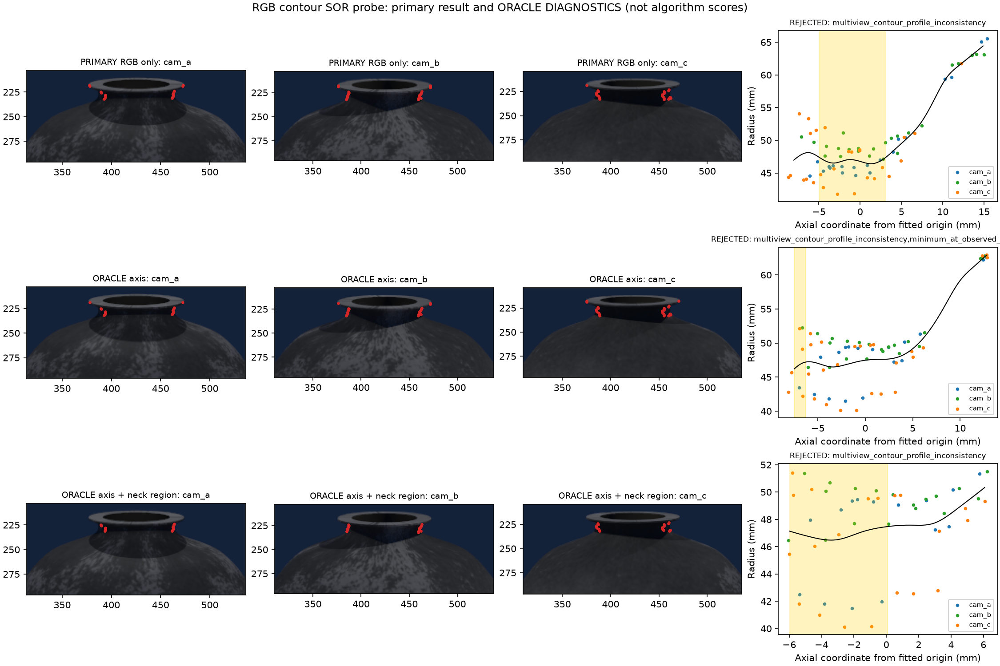

# 不依赖深度的多视图轮廓对照：四例有界试验

日期：2026-10-25。**本轮没有得到可替代深度定位的算法：四例主方法全部失败，保留为可复现负结果。**
多视图旋转曲面重建有直接文献依据，但“有成熟几何理论”不等于现有短颈图像能直接得到毫米精度。
本实现是小型几何对照，不是作者完整算法的复现，也不是所有 RGB 方案的否定。

## 文献依据与可观测性

- Wong、Mendonça、Cipolla 的[单视图旋转曲面论文原文](https://i.cs.hku.hk/~kykwong/publications/kykwong_ivc2004.pdf)
  利用轮廓和曲面法向与轴共面的性质恢复母线；单视图存在尺度和轴姿态歧义。
- Zhang、Wong、Mendonça 的[多视图轮廓联合优化论文原文](https://hub.hku.hk/bitstream/10722/137137/2/Content.pdf)
  联合优化母线与相机，报告真实图像结果。它使用曲线/母线的约束，不把不同视图轮廓点当成同一个表面特征三角化。

本项目相机 K/T 已知且基线有米制尺度，省去单目未知尺度；旋转曲面假设仍是必要先验。
轮廓只能约束可见外包络。凸口沿挡住的凹槽不能通过增加同高度视图自动恢复，
真实不圆、局部轴与坛身轴不同、短颈只有数个像素都会使估计困难。
当前相机向下看约8–10°，所以必须检查口沿自遮挡，不能默认全部颈段可见。
本轮没有通过独立可见性计算证明哪些颈段完全不可观测，以上是需要检查的边界，不是已验证的唯一失败原因。

## 这次实际实现了什么

输入仅为**三张原始 RGB 与给定的真值 K/T**，不读取深度、GT掩码、坛体模型、已知半径或目标高度。
使用既有 `extract_stereo_masks` 的蓝键前景提取。已知工位体积内的粗视觉锥交集只提供轴初值与搜索位置，
不被当作目标真值；先按近似竖直轴初始化，再允许局部轴偏移和倾斜。

几何步骤是：

1. 从 RGB 外轮廓估计图像切线，将它反投影为过相机中心的切平面，记其世界法向为 ν。
2. 对候选轴 {a,n}，旋转曲面的真实法向与径向、轴共面。因此图像射线应与“轴 n 和 ν 所确定的母线平面”相交。
   其平面法向为 (w=n\times\nu)，射线 (C+t d) 与平面交点满足
   \(t=w^T(a-C)/(w^T d)\)。由交点计算轴向坐标 s 和径向距离 ρ。
3. 用自由三次样条 r(s) 拟合三个视图的这些 {s,ρ}；每次调整四维轴参数时重新求样条系数，
   最小化跨视图不一致及样条系数二阶差分惩罚。没有固定半径模板。
4. 从观察得到的连续 (r(s)\le\min r+1\text{ mm}\) 范围取中点，输出候选圆心、法向、半径。
   这个观察范围尚不保证等于工厂的物理可扎带区间。

上述切线关系与参数化 (p=a+s n+r(s)e_\phi) 一致：
曲面法向正比于 (e_\phi-r'(s)n)，故轮廓条件为
\(e_\phi^T(C-a)=r+r'[n^T(C-a)-s]\)。
四项解析检查覆盖此条件、反投影公式、多视图无尺寸先验轴恢复、单视图尺度歧义。
精确连续轮廓单测可以恢复轴，说明这份实现的解析核心成立；真实像素轮廓中的表现必须另外检验。

**与原论文的区别：**这里为了有界验证采用“先微分轮廓，再反投影，最后联合拟合母线”。
原论文完整的图像曲线优化、相机自标定及可见性处理未复现。
因此当前失败不能作为原论文失败的结论；直接在图像空间优化轮廓距离是尚未实施的改进方向。

## 四例开发结果

使用已生成的蓝背景 v3 四个开发酒坛，普通 RGB，不是新锁定测试集。
阈值沿用圆心4 mm、法向2°、直径2 mm作为分析指标；后两项仍未由工厂确认。
本小对照额外以跨视图轮廓拟合 RMS≤1 mm检查候选一致性，该阈值是明确假设，不是已校准概率。
四个候选均未通过此检查，拒绝计作任务失败。

| 开发例 | 圆心误差 mm | 法向误差 ° | 直径误差 mm | 跨视图RMS mm | 结果 |
|---|---:|---:|---:|---:|---|
| nominal_000 | 3.653 | 2.186 | 7.550 | 2.365 | 失败 |
| nominal_001 | 17.847 | 3.572 | 77.040 | 7.060 | 失败 |
| stress_000 | 25.531 | 17.222 | 41.383 | 3.785 | 失败 |
| stress_001 | 14.700 | 5.994 | 40.680 | 11.257 | 失败 |

正确输出0/4、拒绝4/4、错误接受0/4。
全部候选的圆心误差中位/P95/最大为16.274/24.379/25.531 mm；
法向为4.783/15.538/17.222°；直径为41.032/71.692/77.040 mm。
本轮CPU耗时中位78 ms、P95 91 ms、最大92 ms，不含采集、文件读取和绘图；速度没有弥补正确率。

## 失败证据与分离诊断

每例图的第一行为实际 RGB 主方法选点，红点不是示意，直接来自优化器输入。
后两行分别使用 **GT轴**、**GT轴＋GT轴向颈段**，仅用于诊断，绝不计作算法成绩。
GT区域使用沿真实轴的区间，不把歪颈的轴向区间误作水平高度切片。



可以直接看到：

- 蓝键掩码在深色颈部仍可能向内收缩；例如 nominal_000 的 cam_a 像素(390,227) RGB=[11,17,29]被判蓝背景。
  这种色差阈值需要检查，不能把它与理想物理轮廓混用。
- 轮廓中混有凸口沿的边缘、短直壁及过渡。这些像素并不都对应同一光滑局部旋转曲面的切点。
- 离散轮廓只有有限像素，需要先求切线的反投影容易放大边缘和方向误差；平滑本身也会改变短颈形状。
- 给定GT轴后仍未恢复准确半径；nominal_000 即使给GT颈段，直径误差仍8.545 mm。
  所以不能把失败简单归因于轴局部极小。
- GT轴＋GT颈段下 nominal_001/stress_000 只剩23/19个符合本提取规则的样本，未达到本小拟合器要求的24点。
  这说明当前提取和参数化支持不足，**不是“任何RGB算法都无解”的证明**。

原型 v1 曾把GT区域实现为世界Z切片，已在 v2 改为正确轴向区间；v1保留作开发历史。
两个版本的四个实际主方法候选完全一致，只有诊断和可视化变化。

## 建议

不把此基线并入默认定位器，也不继续堆样条阶数或通过放宽拒绝来制造成功率。
若继续这条路线，优先做**RGB轮廓提取与可见性审计**，然后实现原论文思路的图像空间轮廓优化，避免先微分再反投影。
与深度互补时，可把可靠 RGB 轮廓当作独立投影约束，而不是假定它能够完整补全被口沿挡住的颈段。
本轮只有四个开发例，不足以证明文献空白或形成创新点。

## 复现与代码

```bash
cd /home/wunicheng/Git/WineJar
OPENBLAS_NUM_THREADS=1 OMP_NUM_THREADS=1 \
conda run --no-capture-output -n winejar-stereo \
python scripts/run_silhouette_profile.py \
  --run experiments/neck_localization/runs/active_stereo_development_20261024_v3 \
  --output /tmp/winejar-silhouette-NEW

conda run --no-capture-output -n winejar-stereo \
python -m unittest discover -s tests/neck_localization -p 'test_silhouette_profile.py' -v
```

输出目录必须不存在。全程CPU，不连接设备，不运行渲染。
代码是 `neck_localization/silhouette_profile.py`、`scripts/run_silhouette_profile.py`，
结果入口 `experiments/neck_localization/results/silhouette_profile_development_20261025_v2/`。
其中 `records.json` 包含12条分离记录，`primary_summary.json`只汇总四条主方法，
每例有图和输入契约，`source_snapshot/`保存本次相关源码。
