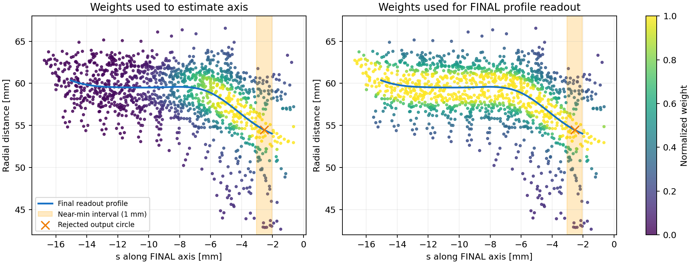

# 截图失败诊断与算法实际结构

2026-10-26，离线读取冻结记录；未重新调参、推理或操作设备。

## 用户第三张截图

用户明确对应 `structural_test_stress_003 / far / stereo_raw / portfolio`。
橙虚线表示被拒绝候选，不是接受输出。四个初值都被拒绝，仍显示评分最低者用于诊断。

- 圆心误差9.074mm、法向0.903°、直径10.161mm。
- 选中深度平面初值；最终圆心在初始口沿平面下2.233mm。
- 最终轴坐标搜索区间−15.044至−2.044mm，近最细区间−3.044至−2.044mm，只有1mm且碰上界。
- 曲线两端半径60.360、54.023mm；最小值位于靠口沿的搜索端，未形成有两侧支持的内部颈谷。
- 留出点径向RMS7.858mm；触发边界、3mm带宽不足、深度不一致、轮廓不一致四项拒绝。
- 显示1376训练点。轴权重有效点数695，最终读出权重有效点数1158；有效点数定义为(sum w)^2/sum(w²)，不是置信度或独立样本数。

横轴是最终轴上的位置s，纵轴为距最终轴的距离ρ。蓝线是最后读出的r(s)，橙叉是输出截面；左右用不同颜色表示同一组点的两套实际权重。图只展示42–68mm径向范围，完整点保留在记录中。
这不是证明求解器全局最优，而是直接显示本例读出的是搜索边缘，不能等同于实际扎带颈段。

## 当前实现的两次拟合

1. RGB前景与实测深度反投影，多视图前景一致性筛点。
2. RGB上沿圆弧与上部深度RANSAC产生至多4个口沿初值；它们不是目标圆。
3. 初始轴下2–45mm取点，粗半径谷裁出局部上下文；至多1800点，用5像素图块分训练/留出。
4. 对每个初值优化轴的横移和倾角。每次轴试探都重新解三次样条系数，最小化加权径向残差和曲线粗糙度；最多5次外层权重更新。
5. 区域反馈仅重加权最初点池，不重新找回被初次裁掉的点。Huber抑制大径向残差，不能识别所有错误表面。
6. **固定最终轴，用另一套权重重拟合整个局部上下文曲线。这里没有沿用区域反馈权重。**原意是保留定义颈段的上下过渡，但使轴拟合与最终圆读出不共享同一目标。
7. 在读出曲线上找全局最小值，取与其连通的“半径≤最小值+1mm”区间中点，输出该截面圆。该区间是算法代理，不等于已识别的物理颈段。
8. 留出深度、区间边界、带宽、半径、RGB轮廓检查后筛候选。后者已有理想真值反例，不能继续作为普适硬约束。

最初排除口沿附近不等于后续目标被约束在真实凸唇下方；轴改变会重新解释s、ρ。内外壁/口沿混入、深度跨边界混合或裁点漏掉转折，均可能使自由曲线最小值跑到边缘。现有记录不能把这些原因逐一因果分离。

## 显示一致性审计

查看器点集来自当前行保存的训练点，圆来自同一行估计；切案例、输入、算法会清缓存。
审计far/close主比较中305个有完整曲线记录的新方法结果：圆心离轴最大4.8e−14mm、离近最细区间中点最大1.6e−13mm；半径与0.1mm网格线性插值的最大差0.00157mm（输出实际用样条求值）。
没有发现该范围内的记录几何错配；这不能证明全部UI交互或优化器均无缺陷。拟合点是三维表面片，并非应落在一个平面的圆周点。

另一个已保存反例 `nominal_005 / far / stereo_raw / portfolio` 的输出比初始口沿平面高1.615mm，说明当前架构确实缺少全过程的物理分支约束；不是用户第三张截图，勿混同。

## 对照应如何理解

七种定位方法：原定位器；新多候选普通；新多候选Huber；Huber+区域反馈；只用首个初值；再加入传播方差权重；传播方差下固定初始轴。
方差分支还改了可见点门槛和粗半径统计，并非纯粹只换权重。新普通与旧算法也同时改变了初始化、采样、样条和检查，不能做单因素归因。
理想、原始双目、窄窗、小窗、相位校正是输入条件，不是全部串联。GP与官方后处理没有叠加到本轮全部主比较中。

完整统计见[原报告](structural_results_20261025.md)。最重要的结论仍是：原布局理想深度原算法12/12正确接受，新区域法7/12；原布局原始双目二者都0/12；窄窗新区域法1正确+2错误接受，单候选2正确且无错误接受。近距原始新区域法候选位置/方向较好，但直径最大8.62mm且全部拒绝。
没有一种新方法在完整任务上稳定胜出。先修复目标定义、区域与读出的一致性，单独验证每项改变，再谈更多模块。

证据目录：`experiments/neck_localization/results/structural_explanation_20261026/`，包括audit.json、用户截图对应完整冻结行及实际曲线图。所有真值误差仅用于评估。
