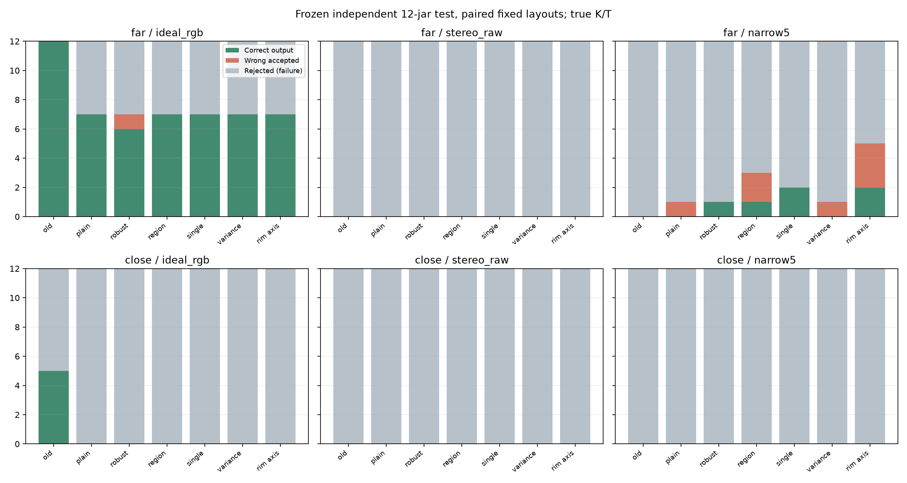
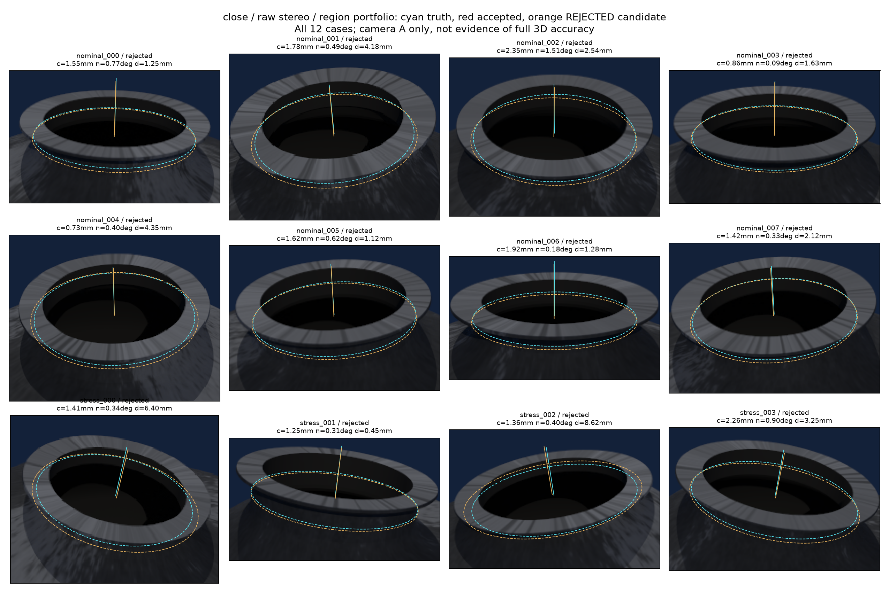

# 多候选、结构验证与主动双目：本轮结果

2026-10-25，离线。**候选圆的位置和法向有改善，但尚未实现较真实深度下的可靠自动定位。新方法不替换默认算法。**

先看三个结果：

1. 原0.8m布局中，原算法与新多候选方法在原始主动双目上均为0/12正确输出。
2. 固定近距俯视布局中，新方法的12个候选圆心最大误差2.35mm、法向最大1.51°，但直径最大误差8.62mm；全部未通过验证。
3. 查明一条新验证约束有误：**局部目标圆的切点不必位于整坛二维外轮廓。**精确真值圆在近距12例中也全部被这条检查拒绝，换理想轮廓仍然如此。

不能把第二项说成定位成功，也不能靠删除第三项拒绝条件宣称问题解决：事后仅删除该条件，会新增5个正确接受和6个错误接受。

## 实际增加了什么

所有分支是对照，不是逐层叠加到运行系统中。

| 项目 | 实现 | 本轮判断 |
|---|---|---|
| 多候选初始化 | 观测RGB上沿圆弧拟合自由3D圆；深度上部多窗口RANSAC产生多个平面/圆心初值 | 能形成更多候选，但筛选还不可靠；不是CN122289742A完整复现 |
| 结构支持与拟合 | RGB多视图投影一致性筛掉明显外部点；粗半径谷确定局部点集；3mm节点样条与局部轴联合拟合 | 理想深度可拟合；噪声下仍有错误范围、直径偏差及偏轴 |
| 权重消融 | 普通权重、Huber、区域反馈、单候选、方差传播、固定口沿轴 | 没有一个在完整噪声任务上稳定胜出；相机信任均为1，不按各机点数强行平衡 |
| RGB轮廓验证 | 目标截面两个圆柱切点投影应贴合每台相机整坛外轮廓 | **假设已被反例推翻，不应作为通用硬条件** |
| 匹配支持对照 | 同一IR图与内部噪声种子，默认7×7 Census/7×7聚合，对比3×3/3×3和5×3/3×1；后两者关闭中值滤波 | 有些候选恢复，但错误接受增加；不是只改变一个参数的消融，也未优化SGM惩罚，不能否定所有小窗口方法 |
| 周期视差补偿 | 独立已知平面学习6个系数：常数、线性、两阶正余弦；在量化/对齐前校正原生深度 | 平面误差下降，酒坛任务未改善；映射还存在非单调区段，不采用为默认 |
| 查看工具 | 10个保存条件可鼠标切换；新增算法按钮、橙虚线拒绝候选、中心/法向/直径评估显示 | 输入、候选、接受状态与评估真值明确分开；近距深度色标单独设置，不改深度数值 |

源码：`neck_localization/structure_portfolio.py`、`structural_localization.py`、`disparity_calibration.py`。
`ray_profile.py`另保留开发期的图像空间原型：4开发例中有明显直径错误和错误接受，未进入主比较。
旧定位器、旧传感器和实机配置未改，没有训练网络或操作设备。

## 数据、冻结与相机布局

- 4个既有开发坛型用于调试；新种子2026102519生成8常规+4压力坛型，物理颈长先设不小于6.2mm。
- 同一12坛型成对比较两个布局，**不是24个独立酒坛**。新观察生成前冻结算法、模型和配置。
- 原布局：距离0.8m、方位−50/50/180°、俯视10/10/8°。
- 近距布局：三机水平距坛轴0.35m、高0.78m，均看向世界[0,0,0.60]m；总距约0.394m、俯视约27.2°。
  根据短颈采样和固定高度可见性选定一个对照，无位置网格搜索，也不按每坛真值调整。
- 分辨率、D435预设内参、光照、材料、噪声模型和每案例种子规则不变。距离改变也改变视角、遮挡、投影纹理与入射条件，不能把所有差异归因于像素数量。
- 仍是照片参考的圆截面模型族、准确K/T、各投影器依次独立工作。未加入本轮新标定误差、输送/TCP误差、真实IR材料辨识或非圆缺陷。
- 主比较52组方法/条件，共624次。另有32次oracle诊断及开发原型；随后追加288次原生IR诊断，**追加部分已看过主测试，不能算新的未见测试**。

工艺和坐标约定沿用：世界米制、+Z向上；相机OpenCV右/下/前；深度为光轴Z，T_world_from_camera将相机点变到世界。
法向取n_z>0。圆心≤4mm、法向≤2°、直径≤2mm为当前分析阈值，后两项还不是已确认工艺指标。
拒绝与异常都算失败，错误接受单列；3mm整带包含另算。没有经过校准的不确定度输出。

## 完整输出率

| 布局/输入 | 方法 | 正确接受 | 拒绝 | 错误接受 |
|---|---|---:|---:|---:|
| 原布局/理想RGB深度 | 原算法 | 12 | 0 | 0 |
| 原布局/原始双目 | 原算法 | 0 | 12 | 0 |
| 原布局/原始双目 | 多候选+区域反馈 | 0 | 12 | 0 |
| 原布局/窄窗双目 | 多候选+区域反馈 | 1 | 9 | 2 |
| 原布局/窄窗双目 | 单候选对照 | 2 | 10 | 0 |
| 近距/理想RGB深度 | 原算法 | 5 | 7 | 0 |
| 近距/理想RGB深度 | 多候选+区域反馈 | 0 | 12 | 0 |
| 近距/原始双目 | 多候选+区域反馈 | 0 | 12 | 0 |

不能由单候选2/12、多候选1/12判断多候选上限更低；本次候选排名/验证不足，增加候选还会增加误选机会。
原布局窄窗的两个单候选正确圆中，近最细代理区间的3mm整带成功仍为0，完整物理颈段下为1。
因此细圆误差达标仍不等于完整扎带成功。

全部方法、全部分轴误差和耗时在：

- `experiments/neck_localization/results/structural_stage_20261025/summary.json`、`summary.csv`、`cases.csv`
- 原始完整记录：`experiments/neck_localization/runs/structural_stage_20261025_v1/{far,close}/{main,matching,small_matching,phase_estimates}/`



## 候选几何改善到什么程度

下表含近距原始双目、多候选区域反馈的**全部12个被拒绝候选**，不筛成功例。

| 指标 | 中位数 | P95 | 最大 |
|---|---:|---:|---:|
| 圆心误差 mm | 1.486 | 2.299 | 2.348 |
| 圆心沿真法向误差绝对值 mm | 1.420 | 2.228 | 2.269 |
| 圆心切向误差 mm | 0.450 | 1.021 | 1.099 |
| 法向夹角 ° | 0.399 | 1.172 | 1.507 |
| 直径误差 mm | 2.331 | 7.397 | 8.619 |
| 推理耗时 ms | 768 | 842 | 842 |

原布局同方法候选的圆心中位15.33mm、法向11.42°，近距对候选位置/方向有明显帮助；**直径长尾仍不可接受**。
这些是仿真中有圆候选的误差，不是已通过验收的精度。耗时不含渲染、采集、I/O和校正预处理；本轮有并行分析，非严格受控速度基准。



## 三个已定位的问题

**1. 改初值和裁点仍不够。**
4开发例的2×2 oracle中，理想深度四种条件均正确；原始双目即使给准确初值和外壁支持，仍0/4。
干预仅给真值初值或指出像素归属，未用真值坐标替换测量；有一例形成了圆但中心约5.17mm、直径约2.74mm且被拒绝。
这不是某类算法的不可能性证明，只说明这版冻结求解/读出不能仅靠前端修补恢复。
见`results/structural_oracles_20261025_v2/`，0.09m口沿半径上界是明确的oracle诊断宽界，不能当作实际尺寸输入。

**2. 我加入的轮廓硬验证不普适。**
精确真值圆在原布局观测RGB轮廓上4/12不通过，理想轮廓仍2/12；近距两种轮廓都12/12不通过。
所以问题不只是颜色分割：局部截面切点未必等于整个物体的投影外边界，凸唇/坛肩和投影重叠必须考虑。
近距理想外颈原生像素总数36951，原布局13208；并非“近距完全看不到颈部”。更多点不自动意味着相同的边界约束成立。
下一版应做可见性/表面分支判断，不能要求每台相机都看到目标截面的轮廓，也不能简单删门槛：只删这一理由会放入多个实际错误圆。
见`results/structural_visibility_20261025_v1/visibility.json`及主报告目录的`gate_counterfactual.json`。

**3. 深度表示与残差门槛都不是单独的解药。**
追加原生IR测试沿用已有冻结算法，仅映射原RGB颜色/前景，不重采样深度。
理想IR量化在原布局12/12、近距6/12；原始、窄窗和相位校正深度在两布局均0/12。
把备用验证RMS从0.4扫描到0.8/1.2mm也未改善，因为多数在初始化或范围读出就失败。
这不是更大范围放宽门槛的证明；扫描仅是诊断，不构成已验证的新质量标准。
见`runs/structural_native_diagnosis_20261025_v1/summary.json`。

## 平面补偿为什么有改善，却没有解决酒坛

补偿只读独立平面训练集，93训练、14验证、12原有测试帧。以相同2631724个测试像素重新比较，避免统计口径混淆：

| 对照 | 深度RMSE mm | P95绝对误差 mm |
|---|---:|---:|
| 原始 | 4.285 | 8.926 |
| 已锁GP，512训练点 | 4.300 | 8.944 |
| 线性视差校正，512点 | 4.302 | 8.955 |
| 周期视差校正，512点 | 2.549 | 5.313 |
| 周期视差校正，11904点 | 2.477 | 5.162 |

这支持“应考虑视差相位特征”，而不是仅增加训练点；仍不能把全部GP失败归因于某一个因素，核函数、目标函数和超参数策略也不同。
后续对照已经看过这些平面测试，是解释性诊断，不是又一批新未见测试。

重要局限：自由谐波模型使d+delta(d)约30.9%的相位区段导数为负；它不能作为已验证的可逆标定映射。
近距范围还低于平面训练的0.5m下限，是外推。平面校正也没有学习窄边界跨窗口混合和曲面遮挡，不能期待自动修复这些误差。
因此**不设默认、不把这项包装成官方校准实现**。锁定模型及结果在`results/disparity_calibration_20261025_v1/`，
等样本量对照和导数核查在`results/disparity_feature_diagnosis_20261025_v1/`。

## 可视化与复现

任意目录运行；左栏切远/近、理想/原始/窄窗/小窗/相位条件，滚动左栏可见算法按钮。可以旋转近景，查看实际点云、训练点、权重、原RGB和深度。
青虚线是真值，橙虚线是**被拒绝候选**，红实线是算法接受；接受并不等于评估正确，打开真值时会标出错误接受。
带宽边界可在左栏另开，默认只画圆和法向。查看器不重新推理、不修改图像或深度。

```bash
conda run --no-capture-output -n winejar-stereo \
  python /home/wunicheng/Git/WineJar/scripts/view_structural_study.py --ground-truth
```

两个可直接检查的对照（均为事后选出的展示例，统计仍包含全部12例）：

```bash
# 细圆几何达标，不能据此当作整带/工业成功
conda run --no-capture-output -n winejar-stereo \
  python /home/wunicheng/Git/WineJar/scripts/view_structural_study.py \
  --condition far/narrow5 --method portfolio_single --case structural_test_nominal_001 --ground-truth
# 错误接受：中心4.65mm、法向6.11°、直径6.92mm；界面会明确标红
conda run --no-capture-output -n winejar-stereo \
  python /home/wunicheng/Git/WineJar/scripts/view_structural_study.py \
  --condition far/narrow5 --method portfolio --case structural_test_nominal_005 --ground-truth
```

完整重跑两布局、12坛型、624主比较，输出目录须不存在；同一既有独立平面模型被锁定使用：

```bash
cd /home/wunicheng/Git/WineJar
OPENBLAS_NUM_THREADS=1 OMP_NUM_THREADS=1 \
conda run --no-capture-output -n winejar-stereo python scripts/reproduce_structural_stage.py \
  --output experiments/neck_localization/runs/MY_NEW_structural_reproduction

# 对已完成目录生成统计、输入审计或查看束，各输出须为新路径
conda run --no-capture-output -n winejar-stereo python scripts/report_structural_stage.py \
  --run experiments/neck_localization/runs/MY_NEW_structural_reproduction \
  --output experiments/neck_localization/results/MY_NEW_structural_report
conda run --no-capture-output -n winejar-stereo python scripts/validate_structural_stage.py \
  --run experiments/neck_localization/runs/MY_NEW_structural_reproduction \
  --output experiments/neck_localization/results/MY_NEW_structural_validation.json
conda run --no-capture-output -n winejar-stereo python scripts/export_structural_viewer.py \
  --run experiments/neck_localization/runs/MY_NEW_structural_reproduction \
  --output experiments/neck_localization/results/MY_NEW_structural_viewer
```

追加原生诊断可用`evaluate_structural_native.py --run RUN --output NEW_DIR`；它不在624主比较内。
重拟平面模型用`fit_disparity_calibration.py --manifest experiments/neck_localization/runs/active_depth_calibration_20261024_v1/manifest.json --output NEW_DIR`。
环境仍为`winejar-stereo`，依赖沿用`requirements-active-stereo.txt`，GPU/Vulkan/OptiX要求不变。

本轮完整主比较实际运行完成；首次因JSON重新排版的字节校验，以及旧渲染脚本附带定位对照的不足3点异常中断。
保留原件和中断记录，只修导出格式、拆分渲染、在外层将异常记失败，未调整冻结定位器来通过测试。
新复现入口统一独立渲染；`--resume`仅复用有完成标记的组，不覆盖半成品。
冻结源、最终执行脚本、小模型和624+288完整压缩记录另保存在主结果目录`artifacts/`，附SHA256清单；
它们是历史审计副本，不是应覆盖当前源码的另一个运行目录。查看束引用大观测/网格，迁移须保留runs源目录或重新生成，不能只复制查看束。

## 核查与下一步

624条主记录完成；两套冻结源与配置匹配，72个默认IR重放逐像素一致。
566组、832083个实际拟合点与保存深度/K/T反投影匹配；核查960份观测，验证期间散列未变。
另4次禁止读取evaluation_only的代表推理重跑结果匹配。80项单测中78通过、2默认显示跳过；桌面3项通过。
15步原导航回调检查和90份旧输入散列检查通过；新查看束360组RGB掩码/输入检查通过。
新增16步查看器回调覆盖切方法、跨条件保留方法/视角、拒绝候选与错误接受标示，90份输入不变，实际GL回读截图在`results/structural_viewer_checks_20261025_v1/`。
追加原生288条中123组245214个拟合点也与保存原生深度一致。两案例独立重渲染24组RGB/深度及6个原生数组束完全相同。
未声称完整第二次重渲染全部24场景。

下一阶段建议集中在**原生测量几何、多候选初始化、内外壁/凸唇分支与可见性联合判断，以及独立参考下的直径偏差**。
不要继续增加未经验证的硬拒绝条件，也不要只提高迭代次数。先在开发例解释“为什么正确圆被拒绝、错误尺寸仍能低残差”，
冻结改进后另锁新坛型；本轮12例现在均为已查看资料，不能继续调参后称未见测试。
尚不进行位置搜索、网络训练或实机恢复；真实设备/标定、非圆坛颈、输送与末端作业仍需独立验收。

来源边界：[实验约定](structural_experiment_plan_20261025.md)、用户提供的CN122289742A权利要求1–7及说明书[0035]–[0058]、
[ISPRS圆重建论文](https://isprs-annals.copernicus.org/articles/II-3/143/2014/)、
[SAPIEN官方参数源码](https://sapien-sim.github.io/docs/_modules/sapien/sensor/stereodepth.html)、
[RealSense亚像素线性白皮书](https://dev.realsenseai.com/docs/white-paper-subpixel-linearity-improvement-for-intel-realsense-depth-cameras/)。
后者描述真实D400的亚像素非线性与芯片参数；本轮谐波补偿是我们独立的工程对照，不是其A-factor实现，也不是新颖性结论。

**判定：理想几何可行性保留；候选位置/法向在特定近距仿真中改善；完整抗噪可靠输出未达标；实机有效性未验证。**
