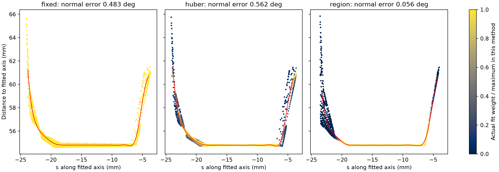

# 鲁棒加权、支持区域反馈与相机系数：首轮对照

2026-10-23。仅离线理想RGB-D仿真；固定相机布局和分辨率，准确K/T。
本轮按用户同意的范围检验两件事：用相机系数表示信任、用鲁棒权重或区域反馈抑制非共轴过渡段拉偏。
没有操作实机、搜索相机位置、加传感器噪声或训练网络。

**结果：区域反馈明显降低了本轮短颈法向误差；Huber单独使用没有稳定解决该问题。
圆心与作业范围误差没有同步改善，尚不能称整个定位问题已经解决。**

## 1. 对照设计

共14个已查看开发坛型、6个实现前锁定的新坛型。三种视图组合×三种拟合策略×两种相机规则，
分别252条开发与108条新测试记录。测试规格先写入plan.json，开发结束冻结源码与参数后才生成/评价测试。
6例仍属于同一参数化圆截面模型家族，不是对真实非标准坛型的泛化检验。

所有六组使用完全相同的普通RGB前景、深度、初始化和初始候选超集，每相机最多2500点。
不读取真值掩码、真实颈段、模型规格或目标元数据；评分器只在估计器返回后读取真值。

相机规则：

- `balanced`：每相机总权重相同，等价于每点基础权重与该相机点数成反比，再统一归一化。
- `equal_trust`：三相机信任系数均为1，每点基础权重1；没有按点数作相机平衡。

两种基础权重之和都为N，固定样条正则项不变，避免只比较权重整体尺度。
相机可靠性、逐点几何支持是两个不同因素；本轮不模拟或验证“已知不同标定质量时”的信任分配。

拟合策略：

| 策略 | 点集 | 权重如何变 | 轴如何求 |
|---|---|---|---|
| `fixed` | 同一候选超集 | 基础权重固定 | 原五初值轴/样条变量投影 |
| `huber` | 同一候选超集 | 按径向残差更新Huber权重 | 外层IRLS、内层轴/样条变量投影 |
| `region` | 同一候选超集 | 按当前轴下的连续低半径核心更新软权重 | 轴更新反馈到核心区域，再重新拟合 |

原`joint_profile.py`与旧基线保持冻结。新模块`support_feedback.py`复用其已检查的约化残差/导数，
只显式设置固定的逐点权重；变权之后清除缓存。
42组开发案例的`fixed_balanced`圆心/法向/直径逐项匹配旧冻结联合法，最大数值差小于1.2e-13。
这保证主要对照不是重新写一个不同基线。

## 2. 两种更新的具体机理

### Huber：残差大则降低影响

采用阈值δ=0.10 mm：

$$h_i=\min(1,\delta/|e_i|),\qquad e_i=\rho_i-r(s_i).$$

每轮固定当前h，重新求轴及样条，再更新h。对应代价小残差为e²、大残差为2δ|e|−δ²。
平滑项仍保持原样；不对h重新归一化，否则不再对应这一个固定Huber目标。
最多12轮，并检查轴位置、角度、权重变化的停止条件。开发日志中的真实Huber目标逐轮下降。

δ是针对当前理想深度诊断的工程设置，**不是RealSense噪声标准差或已标定置信度**。
参考[Huber损失及重加权的官方说明](https://ceres-solver.readthedocs.io/latest/nnls_modeling.html)。
本轮是经典IRLS应用，不将其称为创新算法或全局收敛保证。

### 区域反馈：降低不属于短颈核心的连续结构影响

每次轴更新后，用同一批观测点重新计算s、ρ：

1. 轴向0.5 mm分箱，每箱至少8点，以半径中位数表示该箱。
2. 找到最小中位数所在的、半径不超过该最小值+0.30 mm的连续区间[l,u]。
3. 核心内权重高，核心外随到该区间的距离d平滑下降：

$$m_i=0.001+0.999\exp[-d(s_i,[l,u])^2/(2\times(0.50\text{ mm})^2)].$$

4. 将基础权重×m归一到总和N，保持平滑项的整体相对尺度，再重新联合估计。
5. 最多12轮，达到轴位移<0.005 mm、角变化<0.002°、平均权重变化<0.015才算反馈稳定。

核心至少3 mm轴向跨度、80点、90°周向覆盖，且不能碰到候选边界。
这些是可检查的工程先验，不是真实坛颈规格，也不保证应对多槽、多分支或任意非圆曲面。
所有候选保留非零权重，且保存每点权重与每轮核心边界、轴参数，能查出实际发生的筛选。
只有原候选超集内的权重会变化，仍不能恢复初始化门限已经排除的表面。

这版用低半径连续区域作为支持假设，尚未实现显式多曲面分段或跨相机残差一致性驱动的区域模型。
每种策略从同一五初值的最低L2解开始；反馈阶段不再对所有初值分别跑完整迭代，仍有路径依赖。

### 轴拟合区域与目标范围分开

最终轴确定后，**六组都用相同的完整候选上下文、基础权重重新拟合固定轴样条**，
再读取r≤r_min+1 mm的连续范围中点。这样不会用较窄的轴核心冒充作业范围，也不切掉两端支持。
Huber/region的轴拟合曲线与这个统一读出曲线可能不同，诊断图必须说明画的是哪一条。

拒绝判据检查加权轴拟合RMS、数据条件数、参数边界、法向/尺寸、读出范围两端支持；
还检查目标范围及两端各1.5 mm内的未加权径向RMS≤0.4 mm。
全候选RMS始终保留在日志，但对区域法不能用远离目标的过渡段RMS代替目标读出质量。
开发pilot_v1曾这样误拒绝：轴已改善，但下方模型不适用区域使全局RMS仍大。
随后在开发阶段改为上述目标上下文检查，阈值未放宽，v2/v3及冻结评价采用相同规则。
`fixed`的轴RMS仍是全候选RMS，因此原基线的模型检查保留。

## 3. 新测试结果

以下每行6例，均为`equal_trust`。每格误差为中位数 / P95 / 最大值；单位见列名。

|视图|策略|法向°|圆心mm|直径最大mm|
|---|---|---|---|---:|
|单|fixed|0.113 / 0.664 / 0.845|0.250 / 0.962 / 1.062|0.190|
|单|huber|0.075 / 0.687 / 0.879|0.219 / 1.034 / 1.150|0.088|
|单|region|0.058 / 0.212 / 0.226|0.292 / 1.069 / 1.085|0.036|
|双|fixed|0.091 / 0.599 / 0.718|0.395 / 0.946 / 0.952|0.046|
|双|huber|0.085 / 0.606 / 0.683|0.390 / 0.919 / 0.936|0.035|
|双|region|0.017 / 0.129 / 0.135|0.401 / 0.962 / 0.998|0.041|
|三|fixed|0.077 / 0.494 / 0.541|0.425 / 0.898 / 0.943|0.037|
|三|huber|0.063 / 0.535 / 0.569|0.414 / 0.881 / 0.921|0.037|
|三|region|0.019 / 0.101 / 0.105|0.423 / 0.947 / 0.985|0.038|

六组×三视图组合共108次新测试，均接受且满足4 mm/2°/直径2 mm分析阈值，因此本批次成功率100%、拒绝率0%、错误接受率0%。
后两项阈值仍未工艺定案，小样本零失败不是可靠性保证；阈值较宽，不能靠成功率识别本轮法向差异。
每条件n=6的经验P95/最大不能外推为总体上限。

完整六组统计、XYZ、沿法向/切向、全部拒绝记录和耗时在[结果表](../../../experiments/neck_localization/results/support_feedback_20261023/report/tables.md)。
法向正号朝向坛口；直径误差为半径误差两倍。未输出概率协方差，不做覆盖率声明。

### 相机规则的影响很小，不能归因于信任权重

在新测试所有配对中，两种相机规则的误差变化最大约0.0055°法向、0.0072 mm圆心。
单相机两规则完全相同。区域法在两种规则下都有相近法向收益，因此主要收益来自支持区域。
这不检验真实不同标定质量下信任加权的价值：本轮相机没有精度差异或偏差。
统一信任作为当前实验解释更清楚，但它也没有解决相关点/重复采样的信息重复计算。

### 法向改善不等于圆心改善

三视图圆心最大0.943→0.985 mm。平底近最细范围没有唯一点，当前算法允许范围延伸到邻接曲面，
而生成真值只在标注颈段定义范围；该已知端点定义差异仍未解决。
本轮没有重新定义真值来获得更小误差，也没有把下降的轴残差当圆心准确。

## 4. 开发案例与不利发现

已查看案例`test_oblique_flat`三视图：

|策略，equal_trust|法向°|圆心mm|
|---|---:|---:|
|fixed|0.482808|1.023612|
|huber|0.561597|0.982882|
|region|0.055969|1.020326|



横轴为各自最终轴下的s，纵轴为观测离轴距离ρ；不同轴会改变散点位置。
黄色为高权重，深色为低权重，各图按本方法最大实际权重归一显示。
**红线为统一的完整上下文读出曲线**，不是Huber/region用于估计轴的加权曲线。
此图没有读取真值范围；标题误差只在估计后评估。

Huber会降低高残差点影响，但成片、真实的过渡结构仍可能影响轴；已被偏轴解释得残差小的点不会自动失去权重。
因此本轮Huber降低目标值却在平底歪颈上使法向更差，不能将残差大简单等同测量异常。

开发14例中，equal_trust区域法单视图12成功/2拒绝、双视图13成功/1拒绝、三视图14成功。
拒绝来自`tilted_flat`单/双视图与`test_low_flat`单视图，核心碰到候选边界；原固定法这些情况可接受。
Huber双视图有1次反馈未稳定。完整表保留全部尝试，没有把无结果案例误差填零。
区域法有更多支持先验，因此不是对所有输入都更好；没有因新测试全部通过而删除开发拒绝。

### 收益主要来自区域权重，不能单独归因于反复反馈

另做了仅使用上述开发数据的事后机理消融：同一冻结函数只允许一次区域更新，与迭代到稳定对照。
一次更新版有意未满足反馈停止条件，因此只比较候选几何，不把它当作可部署成功率结果。
39组可成对比较：迭代后法向23组略好、15组略差、1组变化≤1e-6°；最大绝对变化约0.047°。

例如`test_oblique_flat/all`，原0.482808°，一次区域更新0.047188°，稳定反馈0.055969°（4轮）。
`tilted_neck/all`则一次0.008122°，稳定后0.008006°（3轮）。
因此主要改善已在第一次引入区域权重时取得，不能声称闭环次数本身带来单调精度收益。
当前停止条件衡量自洽稳定，不等同真实误差最小。
入口`scripts/diagnose_region_feedback_iterations.py`，记录位于结果目录的`iteration_diagnostic.json`；
此消融未改冻结源码、未再使用6例新测试开发方法。

## 5. 验证与复现

24项核心检查通过，含非均匀权重下约化导数、Huber权重/目标一致性、相机规则及无端点常半径区域拒绝。
另外4项查看器检查及3个投影子检查通过。
252条开发记录的查看器点坐标、顺序与原估计器输入逐项一致，着色逐项对应保存的实际权重，未读取GT。
冻结原算法的6个源码散列保持不变。
一键重建已完整执行，252条开发与108条测试的全部字段除`runtime_ms`外逐项完全相同；
重建不算第二套独立测试，见结果目录`reproduction_check.json`。

一键完整重建场景、开发、冻结、新测试、报告：

```bash
cd /home/wunicheng/Git/WineJar
bash scripts/run_support_feedback_stage1.sh experiments/neck_localization/runs/my_support_feedback
```

输出必须是新目录；环境默认`embodied-sim`，可通过`WINEJAR_SIM_ENV`指定已有兼容环境。
脚本只离线运行，不安装依赖、不连接相机或机器人。
定位耗时不含文件读取、采集和渲染；本次三视图中位数约fixed297、Huber340、region355 ms。
本轮完整复现与主评价有并行运行，耗时只作本机记录，不与上轮单进程时间直接作性能结论。

查看新的最明显平底案例及权重：

```bash
conda run --no-capture-output -n embodied-sim python scripts/view_neck_localization.py \
  --scenes experiments/neck_localization/runs/support_feedback_test_scenes_v1 \
  --records experiments/neck_localization/runs/support_feedback_test_v1/records.json \
  --case eval_slender_flat --method region_equal_trust --large-neck --weights --overlay --ground-truth
```

W权重色、C相机来源色、P实体/点云、L原始候选拟合点、M切六种方法、1/2/3换相机组合、G显隐评估真值。
权重色显示实际权重/max；低权重点仍显示，未从图中删掉。
去掉`--ground-truth`即不读取真值文件。查看器本身不重新运行估计。
看开发拒绝，可将scenes换为`preparation_20261022_v5`，records换为`support_feedback_development_v3/records.json`，case用`tilted_flat`并加`--camera-set cam_a`。

## 6. 本阶段留下的问题

保留区域反馈为值得继续的候选，不替换默认历史查看入口，也不宣称全问题解决。
下一步应单独处理范围端点与实际作业位置定义，并检验对核心阈值、短颈长度、有限可见范围的敏感性。
当前6例新测试已被查看，改方法后不能再作为未见评价。
空间相关深度偏差、标定偏差、非圆及真实弱边界仍未验证；这些误差可能让错误区域看起来一致。
本轮证据是**理想仿真中抑制特定模型范围失配的可行性**，不是抗真实噪声或实机有效性。
