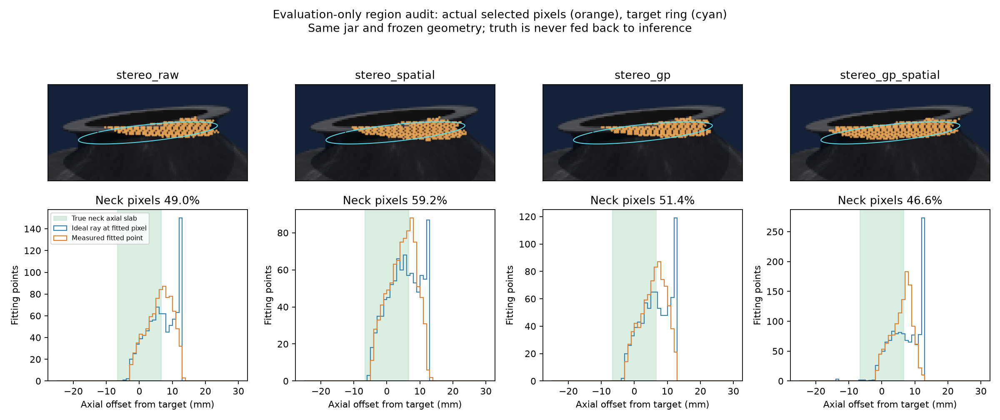

# 后处理消融、拟合区域核查与鼠标导航

2026-10-25。回应用户的三个问题。只读已有观测作诊断并修改显示，冻结定位算法、门槛和历史记录均未改变；未操作实机。

## 后处理与GP是否有用

它们一直是**独立对照分支**，默认`stereo_raw`没有空间滤波或GP；没有把所有模块串起来作为默认算法。
仅使用相同的量化和RGB对齐。官方空间滤波、GP、GP加滤波可分别打开检查，只有证明任务收益后才考虑启用。

已有8坛型任务结果都是0/8正确输出。本次进一步在同一批保存图像上作颈部深度诊断：

| 条件 | 颈部配对像素Z误差RMSE mm | P95绝对误差 mm | 有符号均差 mm | 正确输出 |
|---|---:|---:|---:|---:|
| 原始双目 | 3.814 | 7.712 | −0.271 | 0/8 |
| 官方空间滤波 | 4.068 | 8.541 | +0.468 | 0/8 |
| GP | 3.809 | 7.742 | +0.097 | 0/8 |
| GP加空间滤波 | 4.136 | 8.732 | +0.842 | 0/8 |

这组配置下，滤波没有改善颈部深度误差，GP只略改均值，未带来实用的RMSE或任务改善；组合也没有显示互补收益。
因此继续作为可选消融保留，默认仍用原始分支。不能由本次结果推断所有滤波参数、所有设备或所有GP配置无效。
GP另需约2秒/机的CPU校正（此前记录，非本次受控测速）；更不能仅因为算法成熟就必加。

**统计口径：**8个既有已看测试坛型×3相机；同一RGB像素的深度与理想RGB光轴Z比较，包含RGB注册影响，
不能叫原生传感器绝对精度。使用真值颈轴区间、与生成外轮廓半径相差≤1mm及图像前景限定区域，
只在四分支共同有效的16542个像素上配对，另存各分支有效率，避免因删点产生假改善。
1mm径向容差是明确诊断假设。像素空间相关，不能视为16542个独立样本；这不是新未见测试或真实D435i性能。
上述真值只用于离线评价，不进入定位器或前景提取。

结果：`experiments/neck_localization/results/stereo_support_audit_20261025/depth_comparison.json`。

## L显示的点为什么靠近口沿

L显示保存的**实际拟合训练点**。成功例中它是估计时的支持点；失败例中它可能是最后一次已经准备并尝试的点集，
并不保证已经正确找到坛颈。旧显示叫“拟合点”但没有充分说明这个区别，容易让人误解为已确认目标区域。

对默认`test_nominal_000`的逐点核查：

| 条件 | 训练点数 | 所选像素的理想射线落入颈段轴向范围 | 落在颈段上方 | 初始口沿法向误差 |
|---|---:|---:|---:|---:|
| 理想RGB深度 | 2289 | 79.6% | 6.1% | 0.001° |
| 原始双目 | 879 | 49.0% | 51.0% | 13.055° |
| 官方滤波 | 921 | 59.2% | 40.8% | 13.466° |
| GP | 829 | 51.4% | 48.6% | 13.377° |
| GP加滤波 | 1208 | 46.6% | 53.1% | 6.040° |

用同一个拟合像素的理想射线位置检查，可以区分“像素本来就选到口沿方向”和“颈部测量被深度误差推移”。
表中是**轴向范围**，并不保证都是外表面；另加径向检查后原始双目真实外颈像素约45.7%，数据单独保留。
颈段上方也不严格等于口沿实体：可能包括其他表面/背景，不能只凭轴向标签直接认作物理口沿。

原始例保存的初始口沿中心距离生成模型口沿顶面中心约18.5mm，法向也已偏13°。
随后算法仍沿这个初始坐标寻找粗最细区间，再裁局部点集；错误初值和深度会把区间向上引，混入口沿及错误表面。
连续反馈在已经受限的区域中拟合，未必能够恢复被排除的真实颈部。
这是前端初始化/区域选择的重要问题，不能只归因于最后的联合求解器局部极小；也尚未用单因素实验证明它是唯一或主导原因。

拟合集可以含少量上下过渡作为形状上下文，**并非每一点都必须位于目标圆或颈段中**；但核心支持和目标读出必须由正确颈部观测约束。
理想例中颈段上方点的权重占比约0.02%；原始失败例约51%，说明当前失败尝试没有形成有效的目标支持权重。



图上橙点是实际选入的cam_a像素，青线为评估真值圆；下方统计三个相机全部拟合点，绿带为真实颈段轴向范围。
蓝色分布是同像素理想深度，橙色是实际测量；展示裁剪/标注不修改算法输入。

## 鼠标导航与显示修正

当前查看器左侧有可点击导航：

- 六种观测条件：原始双目、官方滤波、GP、组合、理想RGB深度、理想IR对齐；切换时保留同一坛型和观察角度。
- 上一只/下一只；实体、全坛点云、实际拟合点；RGB色、来源色和实际权重。
- 相机RGB/深度、相机画面叠线、拟合像素投影、估计圆/法向、评估真值及带宽边界。
- 近景显示/放大、复位；已有不同视图数记录时才启用对应按钮，不在查看时重新运行算法。

快捷键继续有效，画面内已移除快捷键说明；小窗口的左栏可滚轮滚动，滚轮只在三维视区才缩放。
“拟合像素”以橙点在RGB或深度显示副本中标出实际训练点来自哪里，标题同时标注；不修改原始图像。
近景可以独立拖动。深度无效值现在显示黑色，不再与色标近端混淆。
拒绝记录明确写“失败尝试的拟合训练点”；若初始化就失败、根本没有拟合点，显示空点集及原因，
修复了原先L会退回全坛/工位点而造成误解的显示行为。没有用真值补点或伪造候选圆。
近景失败时根据观测点/初始化位置聚焦，替代总固定在0.59m，便于检查不同高度的坛型。

```bash
# 任意工作目录均可启动；关闭旧窗口后重开
conda run --no-capture-output -n winejar-stereo \
  python /home/wunicheng/Git/WineJar/scripts/view_active_stereo.py \
  --condition stereo_raw --ground-truth

# 重做本次评价诊断；目录须不存在
cd /home/wunicheng/Git/WineJar
OPENBLAS_NUM_THREADS=1 OMP_NUM_THREADS=1 \
conda run --no-capture-output -n winejar-stereo python scripts/audit_stereo_support.py \
  --output experiments/neck_localization/results/MY_NEW_support_audit

# 鼠标回调集成验证与实际窗口截图；目录须不存在
OPENBLAS_NUM_THREADS=1 OMP_NUM_THREADS=1 \
conda run --no-capture-output -n winejar-stereo python scripts/verify_viewer_navigation.py \
  --output experiments/neck_localization/results/MY_NEW_navigation_check
```

显示没有改变原始RGB/深度或任何历史估计结果。6项导航单测通过；集成检查注入鼠标位置调用真实点击回调，
覆盖15步、6种条件、4种原生对照、同坛同视角、小窗口滚动及初始化失败空点集；90份输入文件哈希不变。
快照从实际GL窗口回读，见`results/viewer_navigation_integration_20261025_v2/`的图片和`validation.json`。
定位器/传感器冻结源码与模型哈希复核通过。后续优先研究可靠初始化、支持区域与轴的反馈及匹配误差，
本步没有靠改阈值或真值筛选提高定位成绩。
